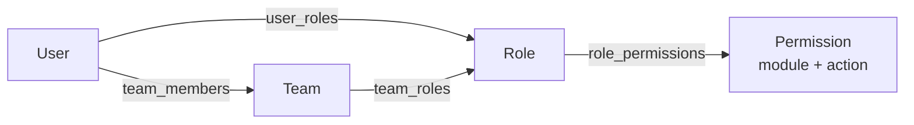
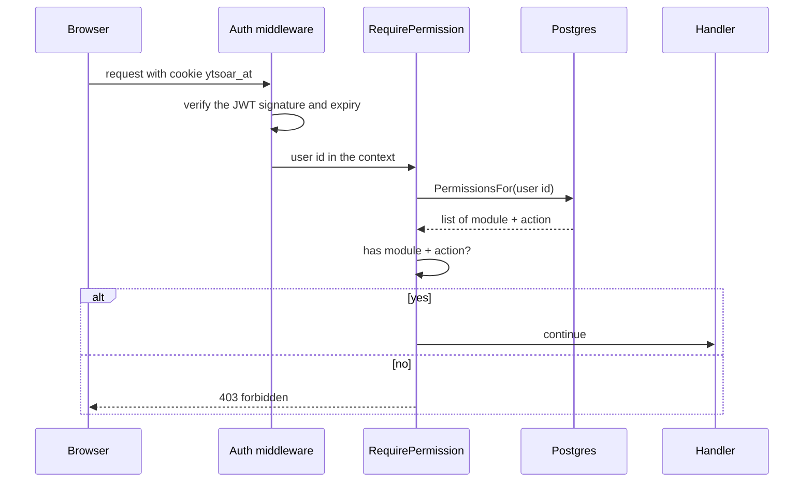
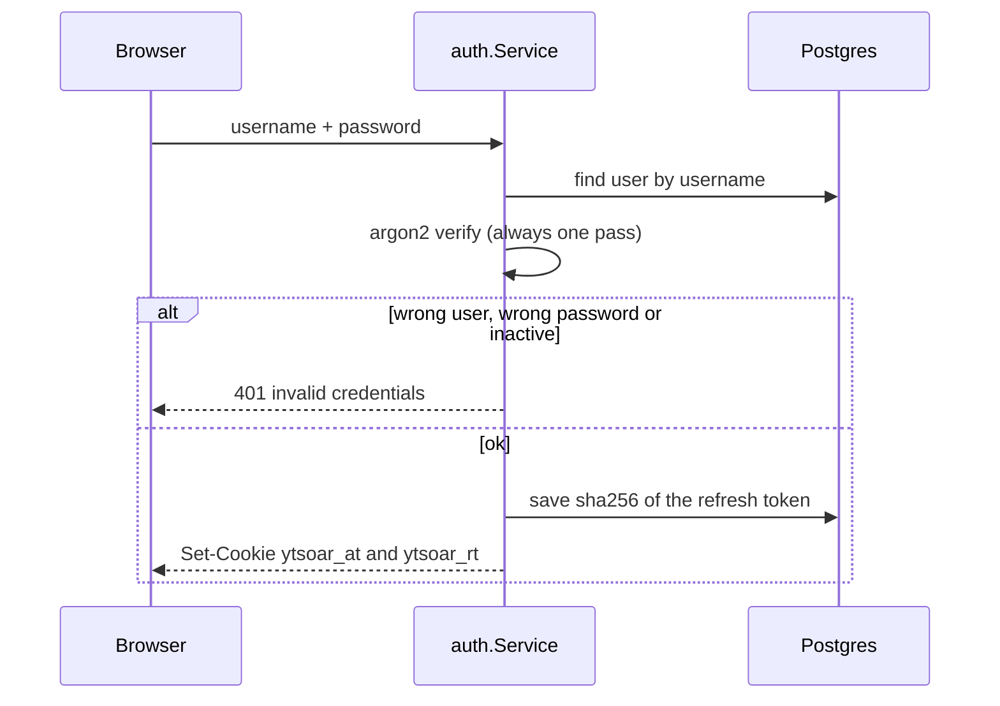
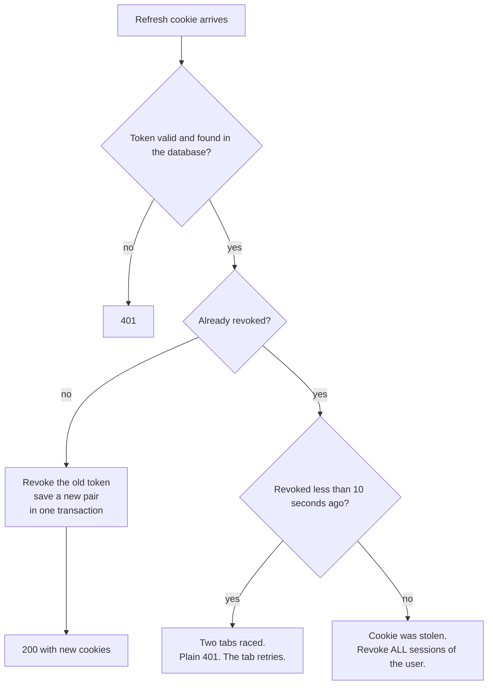
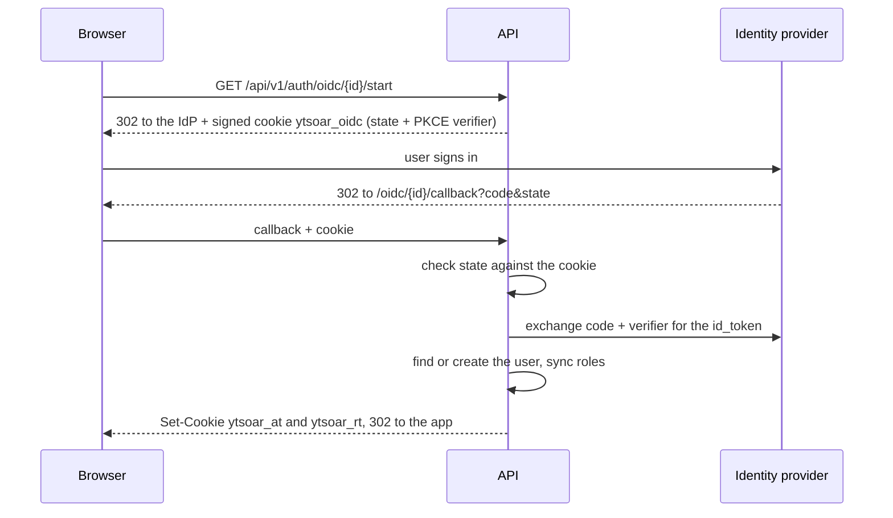

# Auth: users, roles, teams and sessions

This page explains how sign-in and access control work. It covers local sign-in, SSO (OIDC), users, roles, teams and permissions.

## 1. The big picture

Five ideas. Learn these first.

| Word | What it is |
|---|---|
| **User** | A person who signs in. Table `users`. |
| **Permission** | One pair: a **module** and an **action**. Example: `playbooks` + `execute`, `approve`. |
| **Role** | A named set of permissions. Example: `analyst`. |
| **Team** | A named group of users. A team can have roles. Every member gets them. |
| **Session** | An access token and a refresh token, saved in cookies after sign-in. |

A user gets permissions in two ways. The system joins both ways, so there is no clash.

Example. Ana is in the team `soc-night`. The team has the role `analyst`. Ana also has the role `viewer` by herself. Ana gets the permissions of `analyst` and `viewer` together.

## 2. Modules, actions and built-in roles

The lists are constants in the domain code. A new module is a code change. It is not a migration. Keep the list in step with `app/frontend/src/settings/permissions.ts`.

- **Modules:** `playbooks`, `alerts`, `incidents`, `connectors`, `agent`, `schedules`, `settings`.
- **Actions:** `read`, `create`, `update`, `delete`, `execute`.

The first auth migration makes three built-in roles.

| Role | What it can do |
|---|---|
| `admin` | Every module, every action. |
| `analyst` | Daily SOC work. `playbooks`: read, create, update, execute. `alerts`: read, create, update, approve. `incidents` and `schedules`: read, create, update. `agent`: read, execute. `connectors`: read. No `settings`. |
| `viewer` | `read` on everything except `settings`. |

Built-in roles are protected. You cannot edit their permissions (`ErrBuiltinRole`). You cannot delete them. You can still give them to users and teams.

## 3. How one request is checked

Every API call under `/api` passes two checks.

Important points:

- **Auth middleware** reads the access token. It reads the cookie `ytsoar_at`. It also accepts the header `Authorization: Bearer ...` (for scripts and services). The header wins.
- **RequirePermission** asks the database on every request. It does not read roles from the token. A role change or a deactivation works at once.
- If the database fails, the answer is an error. The system never gives access when it cannot check (fail closed).
- Each route file declares its grant. Example: `requirePermission(domain.ModulePlaybooks, domain.ActionRead)`. A test checks the grants of all routes.

One SQL query (`ListPermissionsForUser`) joins the direct roles and the team roles with `UNION`. Both parts filter `is_active = TRUE`. A deactivated user has no permissions, also through a team.

## 4. Local sign-in

`POST /api/v1/auth/login` with a username and a password.

- **Same error, same time.** Every failure gives the same `401` and runs one argon2 pass. An attacker cannot learn which usernames exist from the reply time.
- **Tokens.** Both are JWT, signed with `JWT_SECRET`. The access token lives 15 minutes (`ACCESS_TOKEN_TTL_MINUTES`). The refresh token lives 7 days (`REFRESH_TOKEN_TTL_HOURS=168`).
- **Cookies:** `ytsoar_at` (access), `ytsoar_rt` (refresh). They are `HttpOnly` (scripts cannot read them) and `SameSite=Lax` (cross-site pages cannot send them on POST). The path is `/`, because nginx removes the `/auth-api/` prefix.
- **Refresh tokens in the database.** The table `refresh_tokens` keeps only the SHA-256 hash. A leaked table gives no usable token.
- Each login and each failure writes a row in `audit_logs`.

## 5. Refresh, reuse and logout

`POST /api/v1/auth/refresh` uses the refresh cookie. The frontend calls it when the access token ends.

- **Rotation.** Each refresh makes a new pair and revokes the old refresh token.
- **Reuse detection.** A revoked token that comes back after more than 10 seconds (`reuseGraceWindow`) means a thief used a copy. The system revokes every session of that user.
- **Logout** (`POST /api/v1/auth/logout`) revokes the refresh token and clears both cookies. It has no auth check on purpose. It works with an expired access token. It can only revoke the cookie of the caller.
- **WebSocket.** `/ws/playbook` cannot send headers from a browser. It uses the refresh cookie. The token is read and checked in the database. It is never rotated here.
- **Old rows.** `DeleteExpired` exists, but nothing calls it yet. It needs a single scheduled job.

## 6. SSO with OIDC

An admin adds a provider (Keycloak, Google, Azure and so on). The provider is a row in `auth_providers`. It is not an environment variable. The `config` column is JSON.

| Field | Meaning |
|---|---|
| `issuer`, `client_id`, `client_secret`, `scopes` | Standard OIDC settings. |
| `internal_issuer` | Dev only. The API finds the IdP at this URL. The browser uses `issuer`. |
| `groups_claim` | Token claim with the groups. A dotted path works (`realm_access.roles`). Default `groups`. |
| `group_role_mapping` | IdP group -> one or more YTSoar roles. |
| `default_role` | Role for a user with no mapped role. |
| `sync_mode` | What to sync at each login. See below. |
| `allow_jit` | Create the user on the first login. |
| `username_claim`, `email_claim`, `first_name_claim`, `last_name_claim` | Profile claims. |

The flow. The routes are public because the browser has no session yet.

Rules:

- **No server session store.** The state and the PKCE verifier live only in the signed cookie `ytsoar_oidc`. It is single-use.
- **Failure.** Any error caused by the browser gives `ErrOIDCState`. The user lands on `/login?error=sso`. Nothing leaks.
- **User match.** The key is `external_id = <provider id>|<subject>`. The system never links by email. An IdP with unverified emails could take over a local account.
- **JIT.** If the user is new and `allow_jit` is true, the user is created. The username comes from the claims. The system adds a suffix when the name is taken.
- **Roles.** Groups map to roles with `group_role_mapping`. A group with no mapping counts as a role name (Azure and Okta send role names). Unknown names are skipped. If no role is left, `default_role` applies.
- **`sync_mode`:**

| `sync_mode` | Roles come from the IdP | Profile (name, email) is refreshed |
|---|---|---|
| empty or `roles` | yes | no |
| `all` | yes | yes |
| `attributes` | no (an admin owns the roles) | yes |
| `off` | no (an admin owns the roles) | no |

When roles come from the IdP, they replace the old roles at each login. When they do not, a new user still gets `default_role`. Empty claims never blank a value that someone set by hand.

- The username is never synced. It is the login id.
- After the login the session is the same as a local one. Refresh, logout and permissions work in the same way.
- **LDAP.** The enum `auth_provider_type` has `ldap`, but there is no LDAP code yet.

The password and the secret in a provider config are masked in admin responses. If the admin saves the masked value back, the stored secret stays.

## 7. Manage users, roles and teams

All these routes need the `settings` module.

| Area | Routes (`/api/v1/...`) | Grant |
|---|---|---|
| Users | `GET/POST users`, `GET/PUT users/:id`, `PUT users/:id/roles`, `PUT users/:id/password`, `DELETE users/:id` | `settings` read, create, update, delete |
| Roles | `GET/POST roles`, `GET/PUT roles/:id`, `PUT roles/:id/permissions`, `DELETE roles/:id` | same |
| Teams | `GET/POST teams`, `GET/PUT teams/:id`, `PUT teams/:id/members`, `PUT teams/:id/roles`, `DELETE teams/:id` | same |
| Audit log | `GET audit` | `settings` read |
| SSO providers | `GET/POST auth-providers`, `PUT auth-providers/:id` | same |
| Assignee list | `GET users/assignable` | none (any signed-in user) |

Rules to remember:

- **Users are never hard-deleted.** `DELETE` deactivates the user. Audit rows and connectors point to the user. Deactivation also revokes every session. A set password does the same.
- **You cannot deactivate yourself.** It is easy to do by mistake and hard to undo.
- **Set roles = replace.** `PUT .../roles` and `PUT .../permissions` replace the whole set in one transaction. They never append. An empty list clears the set.
- **Check before write.** An unknown role id fails before any write, with a clear error.
- **A team role is a big grant.** It raises the rights of every member. It needs `settings.update` and it is always written to the audit log.
- **The audit log is read-only.** No route edits or deletes it.
- **Assignee list.** `users/assignable` has no `settings` check on purpose. An analyst must be able to name the assignee. It returns only `id` and `username`.
- **Teams on alerts.** `alerts.team_id` and `incidents.team_id` are labels for ownership. Only `team_roles` gives rights.

## 8. The first admin

A new database has roles but no users. At start, `EnsureAdminUser` checks: "Does anyone hold the admin role?" If not, it creates the user from `ADMIN_USERNAME`, `ADMIN_EMAIL` and `ADMIN_PASSWORD`.

- If `ADMIN_PASSWORD` is empty, the API starts and writes a warning. Nobody can sign in.
- The check is "any admin", not "the table is empty". Old rows cannot lock everyone out.

## 9. Settings

| Setting | Default | Meaning |
|---|---|---|
| `JWT_SECRET` | `dev-secret` | Signs the tokens. With `APP_ENV=production` the API refuses to start with the default. |
| `ACCESS_TOKEN_TTL_MINUTES` | 15 | Access token life. It cannot be revoked, so keep it short. |
| `REFRESH_TOKEN_TTL_HOURS` | 168 | Refresh token life. |
| `COOKIE_SECURE` | false | Set true when the site uses HTTPS. |
| `CORS_ORIGINS` | localhost:9999, localhost:3000 | Exact list. A wildcard does not work with cookies. |
| `FRONTEND_URL`, `AUTH_PUBLIC_URL` | localhost:9999 | Used by the OIDC callback. |
| `ADMIN_*` | admin / `admin123!` in the sample | First admin. |

The refresh cookie is `SameSite=Lax`. This works because nginx serves the frontend and the API from one origin (`:9999`). If you split them across domains, the cookie needs `SameSite=None` and `Secure`.

The tables are drawn in [database.md](database.md).
