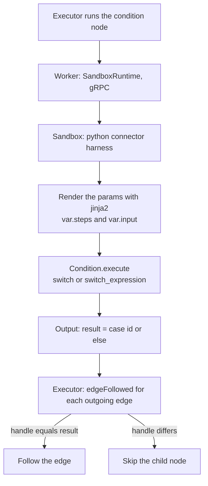

# The condition task

The `condition` connector lets a playbook choose a path. This page explains how it works, and why it runs in Python with jinja2.

## 1. What it does

A condition node looks at data and picks **one branch**. The nodes on the other branches are **skipped**.

It is a **switch**. The node has an ordered list of cases. Each case has an `id`. The first case that matches wins. If none match, the result is `else`.

```text
cases: [ {id: "bad",  ...score > 80},   {id: "mid", ...score > 50} ]
score = 60  ->  {"result": "mid"}
score = 10  ->  {"result": "else"}
```

The node always returns the same shape: `{"result": "<case id>"}` or `{"result": "else"}`.

The connector id is `condition`. It is a normal **Python connector** (`app/connectors/condition/connector.py`). It runs in the **sandbox**, like every other Python connector.

## 2. The two operations

The editor data is in `app/connectors/condition/info.json`.

### `switch` (simple)

Each case is a compare: `left`, `operator`, `right`. The user fills the three fields in the editor. No template syntax to learn. The left and right values can still use `{{ ... }}`.

```json
{ "cases": [
  { "id": "high", "left": "{{ var.steps[\"scan\"].score }}", "operator": ">",  "right": "80" },
  { "id": "ok",   "left": "{{ var.steps[\"scan\"].status }}", "operator": "==", "right": "clean" }
] }
```

| Operator | Meaning |
|---|---|
| `==`, `!=` | Equal, not equal. Numbers compare as numbers only when both sides are plain numbers (`5` equals `5.0`). Ids like `0123` or `1e3` compare as text. |
| `>`, `<`, `>=`, `<=` | Both sides must be numbers. If not, the case counts as **no match**. It does not fail the run. |
| `contains`, `not_contains` | Text search. |

### `switch_expression` (advanced)

Each case is one template expression. The case matches when the result is **truthy**.

```json
{ "cases": [
  { "id": "high", "expression": "{{ var.steps[\"scan\"].score > 80 }}" },
  { "id": "bad",  "expression": "{{ 'malware' in var.steps[\"scan\"].tags }}" }
] }
```

jinja2 turns the expression into a **string** (`"True"`, `"False"`, `"0"`). Then `truthy()` reads the string. These are false: empty, `false`, `none`, `nil`, `null`, `no`, `off`, `[]`, `{}`, and any zero number (`0`, `0.0`, `-0`). Everything else is true.

### Rules for both

- Every case needs a stable `id`. A missing id **fails the node**. A position number would send edges to the wrong branch when the user reorders or deletes cases.
- A compare error in one case is "no match". One bad case does not fail the run.
- The `else` branch always exists.

## 3. How one condition node runs



Step by step:

1. The task parameters are decoded from JSON.
2. `Connector.evaluate_params` renders every string with jinja2. The variables are `var.steps` (outputs of earlier nodes) and `var.input` (the trigger data).
3. The connector reads the rendered `cases` and returns `{"result": ...}`.

### How the executor uses the result

The editor draws each case as a **handle** on the condition node. The handle name is the case `id`. A line from the handle to the next node is an **edge** with `source_handle = <case id>`.

In the executor:

- `conditionResult` reads `{"result": ...}` from the node output. It looks at the **shape**, not the connector id. So any connector or code snippet that returns `{"result": ...}` can act as a condition.
- `edgeFollowed` follows an edge only when its handle **equals** the result. Plain editor handles (`source-top`, `target-left`, and so on) always follow. The single `output` handle of an unrouted condition never follows.
- A node with edges but **no followed parent** is skipped. The skip moves down to its children (`followedCount`).
- A join node with two parents runs when **one** parent followed it.

## 4. Why Python and jinja2

Until issue #38 the condition ran in the worker and used **gonja**, a Go port of jinja2. Python connectors and code snippets use the real jinja2. gonja is close, but not the same. So the same text gave a different result in a condition than in a Python connector:

| Template | jinja2 (Python) | gonja (Go) |
|---|---|---|
| `{{ var.d.get('k') }}` | `1` | **error** |
| `{{ var.d.values() \| list }}` | `[1]` | **error** |
| `{{ var.s.replace('a','z') }}` | `zbc` | **error** |
| `{{ '%d items' % var.a }}` | `100 items` | **`0`, no error** |
| `{{ var.n is false }}` (n is 1) | `False` | **`True`, wrong, no error** |

The ones with no error were dangerous: the condition took the wrong branch, and nobody saw a failure. Now the condition uses jinja2, so a condition and a Python connector give the same result.

### What changed for saved playbooks

The case logic (`compare`, `truthy`, the case ids) is the same. Only the template engine changed. A saved expression that used a gonja behavior can now give the jinja2 result. Also, jinja2 prints a null value as `None`, and gonja printed an empty text. So `{{ x }} == ""` is false for a null `x` now. Use `{{ x is none }}` in a `switch_expression` instead.

## 5. Costs

- **One process for each condition node.** The sandbox starts a new `python3 -I` process for each task. One condition node takes about 0.1 s. In the worker it took less than 1 ms.
- **The condition needs the sandbox.** If the sandbox is down, a condition fails.
- **Sandbox limits.** The sandbox limits (`NODE_TIMEOUT_SECONDS`, memory caps) apply to conditions.

`http_request` still uses gonja for its params. To remove gonja fully, `http_request` must move to the sandbox too.

### Rejected idea

Replace the template language with a Go expression library (for example CEL). It would remove the Python dependency. But it changes the syntax of all saved expressions and splits us from the Python and Node connectors. We rejected it.
