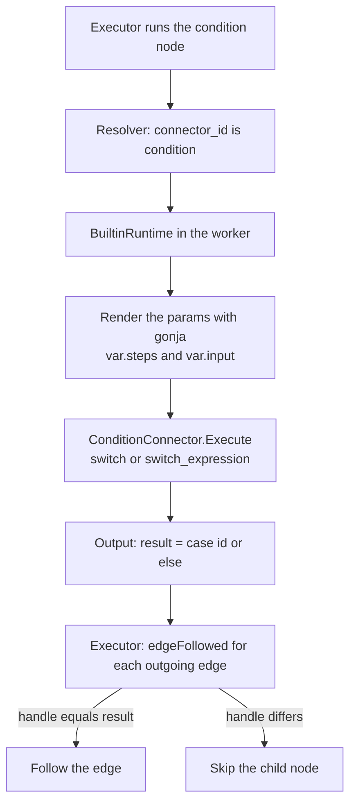
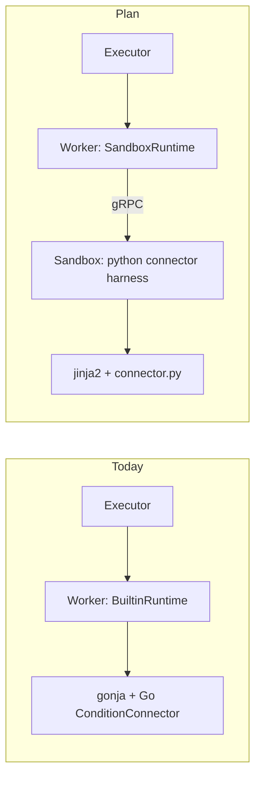

# The condition task

The `condition` connector lets a playbook choose a path. This page explains how it works today, the limits of the Go template engine that it uses, and the plan to move it to Python.

## 1. What it does

A condition node looks at data and picks **one branch**. The nodes on the other branches are **skipped**.

It is a **switch**. The node has an ordered list of cases. Each case has an `id`. The first case that matches wins. If none match, the result is `else`.

```text
cases: [ {id: "bad",  ...score > 80},   {id: "mid", ...score > 50} ]
score = 60  ->  {"result": "mid"}
score = 10  ->  {"result": "else"}
```

The node always returns the same shape: `{"result": "<case id>"}` or `{"result": "else"}`.

The connector id is `condition`. It is a **built-in** connector. It runs inside the **worker**, with no sandbox (`goconnectors.BuiltinRuntime`).

## 2. The two operations

The editor data is in `app/connectors/condition/info.json`.

### `switch` (simple)

Each case is a compare: `left`, `operator`, `right`. The user fills the three fields in the editor. No template syntax to learn. The left and right values can still use `{{ ... }}`.

```json
{ "cases": [
  { "id": "high", "left": "{{ var.steps[\"scan\"].score }}", "operator": ">",  "right": "80" },
  { "id": "ok",   "left": "{{ var.steps[\"scan\"].status }}", "operator": "==", "right": "clean" }
] }
```

| Operator | Meaning |
|---|---|
| `==`, `!=` | Equal, not equal. Numbers compare as numbers only when both sides are plain numbers (`5` equals `5.0`). Ids like `0123` or `1e3` compare as text. |
| `>`, `<`, `>=`, `<=` | Both sides must be numbers. If not, the case counts as **no match**. It does not fail the run. |
| `contains`, `not_contains` | Text search. |

### `switch_expression` (advanced)

Each case is one template expression. The case matches when the result is **truthy**.

```json
{ "cases": [
  { "id": "high", "expression": "{{ var.steps[\"scan\"].score > 80 }}" },
  { "id": "bad",  "expression": "{{ 'malware' in var.steps[\"scan\"].tags }}" }
] }
```

The template engine turns the expression into a **string** (`"True"`, `"False"`, `"0"`). Then `truthy()` reads the string. These are false: empty, `false`, `none`, `nil`, `null`, `no`, `off`, `[]`, `{}`, and any zero number (`0`, `0.0`, `-0`). Everything else is true.

### Rules for both

- Every case needs a stable `id`. A missing id **fails the node**. A position number would send edges to the wrong branch when the user reorders or deletes cases.
- A compare error in one case is "no match". One bad case does not fail the run.
- The `else` branch always exists.

## 3. How one condition node runs



Step by step:

1. The task parameters are decoded from JSON.
2. `TemplateEngine.Render` renders every string that has `{{` or `{%`. The variables are `var.steps` (outputs of earlier nodes) and `var.input` (the trigger data).
3. The connector reads the rendered `cases` and returns `{"result": ...}`.

### How the executor uses the result

The editor draws each case as a **handle** on the condition node. The handle name is the case `id`. A line from the handle to the next node is an **edge** with `source_handle = <case id>`.

In the executor:

- `conditionResult` reads `{"result": ...}` from the node output. It looks at the **shape**, not the connector id. So any connector or code snippet that returns `{"result": ...}` can act as a condition.
- `edgeFollowed` follows an edge only when its handle **equals** the result. Plain editor handles (`source-top`, `target-left`, and so on) always follow. The single `output` handle of an unrouted condition never follows.
- A node with edges but **no followed parent** is skipped. The skip moves down to its children (`followedCount`).
- A join node with two parents runs when **one** parent followed it.

## 4. The limits of the Go template engine

Go has no jinja2. The worker uses **gonja** (`github.com/nikolalohinski/gonja/v2`, version 2.8.0). It is a port of jinja2 to Go. It is close, but not the same. Python connectors and code snippets use the real jinja2. So the same text can give a different result in a condition than in a Python connector.

### What we found

We ran about 100 template expressions through gonja 2.8.0 and through jinja2 3.x. Most gave the same result (for example `trim`, `replace`, `~`, `dictsort`, `in`, `is defined`, `d.k`, `d['k']`). These did not:

| Template | jinja2 (Python) | gonja (Go) |
|---|---|---|
| `{{ var.d.get('k') }}` | `1` | **error** |
| `{{ var.d.values() \| list }}` | `[1]` | **error** |
| `{{ var.s.replace('a','z') }}` | `zbc` | **error** |
| `{{ var.s.strip() }}` | `abc` | **empty text, no error** |
| `{{ '%d items' % var.a }}` | `100 items` | **`0`, no error** |
| `{{ not var.n }}` (n is 1) | `False` | `0` (prints a number, but `truthy()` still reads it right) |
| `{{ var.n is false }}` (n is 1) | `False` | **`True`, wrong, no error** |
| `{{ var.d.items() \| list }}` | `[('k', 1)]` | `[['k', 1]]` |
| `{{ var.a \| round(1) }}` (a is 100) | `100` | `100.0` |

The dangerous ones return a **wrong value with no error**: `strip()`, `%` and `is false`. A condition built on them takes the wrong branch. Nobody sees a failure.

Other rules that come from the engine, and that the code has to handle:

- **Numbers.** `encoding/json` gives every number as `float64`. The code converts whole numbers to `int64` (`normalizeNumbers`), so a template prints `200` and not `200.0`.
- **Data must be maps.** gonja finds fields by Go name. A struct with `Records` does not match `var.input.records`. The code gives plain maps (`RunInput.TemplateVars`). This was a real bug: `Can't use Getitem on None`.
- **Everything is a string.** The result of `{{ ... }}` is text. That is why `truthy()` and the simple `compare()` have a lot of code for text forms.
- **A third-party port.** gonja is a small project. A new jinja2 feature or a bug fix depends on its maintainers.
- **Two engines.** The Go code (gonja), Python (jinja2) and Node (nunjucks) must render the same. We keep this with golden tests. Each new feature needs three checks.

### Workarounds today

| Instead of | Use |
|---|---|
| `x.strip()` | `x \| trim` |
| `x.replace('a','b')` | `x \| replace('a','b')` |
| `d.get('k')` | `d['k']` or `d.k`, and `d.k is defined` to check |
| `d.values()` | `d \| dictsort` or `d.k` |
| `'%d' % n` | `'{}'.format(n)` or `n ~ ' items'` |
| `x is false` | `x == false` |

When in doubt, use the simple `switch`. It does not depend on the template engine for the compare.

## 5. Plan: move the condition to Python

**Goal.** Render the condition with the real jinja2, like every Python connector. No second engine for conditions.

### Why

- One engine, one behavior. The result in a condition matches a Python connector.
- No silent wrong values from gonja.
- Less Go code to keep: `truthy`, text compare and part of `templating`.

### The idea

The condition does not need credentials. It does not need to run in the worker. It can run in the **sandbox** as a normal Python connector. The worker keeps its trust boundary: no Python process in the worker.



The output stays `{"result": "<case id>" | "else"}`. So the executor, the edges and the frontend do not change.

### Steps

1. **Write the connector.** `app/connectors/condition/connector.py`, with `"runtime": "python"` in `info.json`. Port `switch` and `switch_expression`. Use the existing `Connector.evaluate_params` (jinja2). Port `compare` and `truthy` too.
2. **Add a parity test.** Run the same cases through the Go version and the Python version. Fix every difference. Keep the table in section 4 as the first cases.
3. **Switch the route.** Remove `condition` from `BuiltinRuntime` and from the `StaticResolver` list in the worker setup. The `DynamicResolver` in the sandbox then picks the Python harness. Keep `condition` in `reservedIDs`, so nobody can upload over it.
4. **Move the tests.** Port the Go condition tests to Python tests. Keep the integration test as it is.
5. **Delete the Go condition.** Remove the Go condition and its tests.
6. **Optional, phase 2: remove gonja.** `http_request` also uses gonja to render its params. To drop gonja, move `http_request` to a sandbox connector too (`http_request_js` already exists). Then remove the templating package, the `TemplateEngine` port, `normalizeNumbers` and `RunInput.TemplateVars`.

### Costs and risks

- **One more process for each condition node.** A new `python3 -I` process starts for each task. Measure the time. We expect tens of milliseconds. A playbook with many conditions will be slower.
- **The condition needs the sandbox.** Today a condition works even if the sandbox is down. After the change it does not.
- **Old playbooks.** A saved expression that worked with gonja may behave in a different way with jinja2. The parity test (step 2) finds these. Jinja2 is the reference, so we expect the old result to be a bug in most cases.
- **Memory and time limits.** The sandbox limits (`NODE_TIMEOUT_SECONDS`, memory caps) now apply to conditions.

### What does not change

The `info.json` operations and parameters, the editor, the case ids, the edge handles, the executor rules (`edgeFollowed`, skip, join) and the stored playbooks.

### Rejected idea

Replace the template language with a Go expression library (for example CEL). It would remove the Python dependency. But it changes the syntax of all saved expressions and splits us from the Python and Node connectors. We rejected it.

The work is tracked in issue #38.
