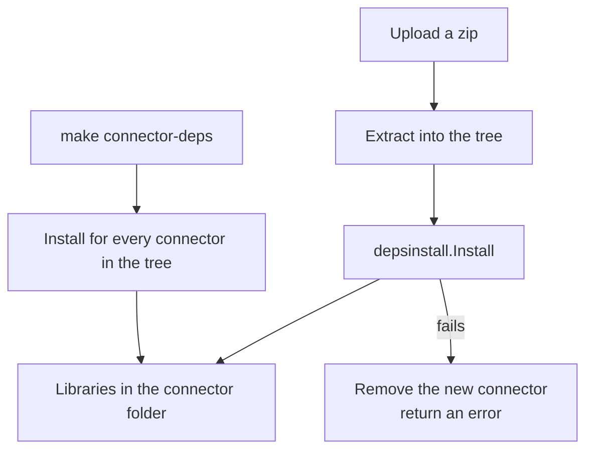
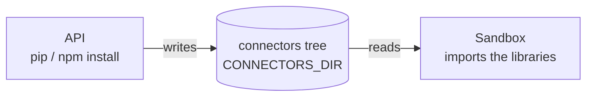

# Connector dependencies

A connector can need libraries. Example: a Python connector that uses `pandas`, or a Node connector that uses `axios`. This page explains how each connector gets its own libraries. For the upload itself, read [connector-upload.md](connector-upload.md).

## 1. The idea

Each connector keeps its libraries **inside its own folder**. Two connectors can use two versions of the same library. They do not clash.

| Runtime | Declare in | Installed to | Command |
|---|---|---|---|
| Python | `requirements.txt` | `<id>/deps/` | `pip install --target deps -r requirements.txt` |
| Node | `package.json` | `<id>/node_modules/` | `npm install` |

A connector with neither file installs nothing.

## 2. When the install runs

1. **At upload.** The install runs right after the extract. It has a 5 minute limit for each command. If it fails, the upload fails and the new folder is removed.
2. **By hand, for the whole tree.** `make connector-deps` runs the same commands in the `ytsoar_api` container. Use it for connectors that you put in the folder yourself (for example the samples, or after you wipe the volume). The stack must run.

## 3. The exact commands

| Command | Why each flag |
|---|---|
| `pip install --break-system-packages --no-cache-dir --quiet --target deps -r requirements.txt` | `--target deps` puts the files in the connector folder, not in the system. `--break-system-packages` is needed on Alpine Python. `--no-cache-dir` keeps the image small. |
| `npm install --ignore-scripts --omit=dev --no-audit --no-fund` | `--ignore-scripts` stops a package from running code at install time. `--omit=dev` skips dev libraries. The other two flags remove noise. |

`npm install` uses `package-lock.json` when the zip has one. Put it in the zip for repeatable builds.

## 4. Where the install runs

The install runs in the **API** process. It does not run in the sandbox. The reason: the API container uses the same Alpine (musl) toolchain as the sandbox image. A library with compiled code (for example `numpy`) must match the system that imports it.

Both programs must see the same tree:

- **Docker dev** (`make rebuild-containers`): one container shares `app/connectors` with the host.
- **Split** (`make start-split`): the API writes. The sandbox mounts the tree **read-only**.
- **`make dev`** (no backend container): `pip` and `npm` run on your computer. Compiled libraries match your OS, and the sandbox is on your computer too. So it works.
- **Production images:** the `api` image has Python and Node with `pip` and `npm`. The `sandbox` image removes `pip` and `npm`. In production, the two must share a volume. A plan (issue #25) will move the install out of the API.

## 5. How the sandbox uses the libraries

Every task runs in a **new process** with a clean environment (only `PATH` and a few values). So the libraries of one connector never leak into another.

**Python:**

1. Put the tree root on `sys.path`.
2. If `<id>/deps` exists, put it at the **front** of `sys.path`. Its versions win over the image packages.
3. Import and run the connector.

**Node:**

1. Node loads `<id>/connector.ts` or `connector.js`.
2. A `require("axios")` walks up from the connector file and finds `<id>/node_modules`. This is the standard Node rule. The harness does nothing special.
3. `NODE_PATH` points to the harness `node_modules` (it has `nunjucks`).

## 6. Base packages and code snippets

A **code snippet** (an inline Python or JS node in a playbook) cannot declare libraries. It gets only the base packages of the sandbox image:

- Python: the standard library, `jinja2`, `requests`, `colorlog`, `pydantic-settings`.
- Node: the Node standard library, `nunjucks`.

To add a base package, change the sandbox stages in `Dockerfile` (production) and `Dockerfile.dev` (dev), then rebuild.

## 7. Limits and gotchas

- The API needs internet access to reach PyPI and the npm registry.
- A re-upload deletes the folder first, so libraries are installed again from zero.
- Compiled libraries must match the sandbox OS and CPU. Do not copy a `deps` folder from a Mac into a Linux tree.
- The install code runs `pip` and `npm` from the connector author. `--ignore-scripts` blocks npm install scripts. `pip` can still run a build step for a source package. This is why the upload grant (`connectors.create`) is the same as "may run code".
- The sandbox has no database or queue credentials, so library code in a run cannot reach them.
- Python `requirements.txt` has no lock by default. Pin the versions (`pkg==1.2.3`).
