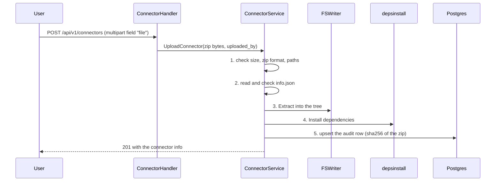
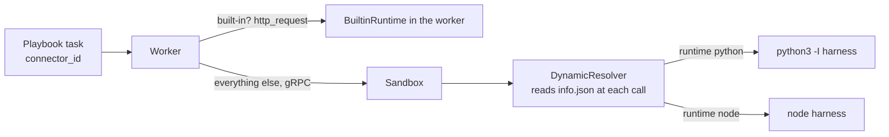

# Connector upload

This page explains how a user uploads a connector as a zip file, and what happens to it. For the libraries that a connector needs, read [connector-dependencies.md](connector-dependencies.md).

## 1. What a connector is

A connector is a folder. It has the editor data and the code. The folder name is the connector id.

```
app/connectors/my_connector/
├── info.json          # name, id, runtime, operations, fields for the editor
├── connector.py       # runtime "python"  (or connector.ts / connector.js for "node")
├── requirements.txt   # python libraries (optional)
└── package.json       # node libraries (optional)
```

All connector folders live in one **tree**. The setting `CONNECTORS_DIR` points to it (`/opt/ytsoar/connectors` in Docker). The tree is the source of truth. A new folder works on the next run. Nobody restarts anything.

Two programs use the tree:

- The **API** writes it (upload and delete). It is the only writer.
- The **sandbox** reads it and runs the code. In the split setup it mounts the tree read-only.

## 2. The upload in one picture



If step 4 or step 5 fails, the service removes the new folder (`removeQuietly`). The user gets an error, and no half-installed connector stays.

## 3. The steps in detail

### The route

`POST /api/v1/connectors`. Multipart form. The zip is in the field `file`. An optional field `uploaded_by` is saved in the audit row.

- The grant is `connectors` + `create`. This is the same as "may run code on the platform", because the upload installs libraries and the code runs in the sandbox.
- The handler limits the body with `http.MaxBytesReader` (50 MB).
- `uploaded_by` comes from the form. It is not taken from the signed-in user. Treat it as a label, not as proof.

### Step 1: check the zip (`validateArchive`)

| Check | Result |
|---|---|
| Zip is larger than 50 MB (`MaxUploadBytes`) | 400 |
| Not a zip file | 400 |
| Zip is empty | 400 |
| Path has a backslash, starts with `/`, or goes up with `..` (zip slip) | 400 |
| An entry is a symlink | 400 |
| The files expand to more than 200 MB (`maxUncompressedBytes`, zip bomb) | 400 |

The zip may have the files at the root, or inside one top-level folder. The service finds that folder (the **prefix**) and removes it. A zip with mixed layout counts as "files at the root".

### Step 2: check `info.json` (`readArchiveInfo`)

| Field | Rule |
|---|---|
| `id` | Must match `^[a-z0-9][a-z0-9_-]*$`. |
| `id` | Must not be reserved: `core`, `code_snippet_py`, `code_snippet_js`, `condition`, `http_request`. |
| `name` | Required. |
| `runtime` | `python` (default) or `node`. |
| runtime file | `python` needs `connector.py`. `node` needs `connector.ts` or `connector.js`. |

Reserved ids protect built-in code. `core` is the shared base class. The two snippet connectors are virtual (the sandbox runs them). `http_request` is compiled into the worker, and the resolver picks built-ins first, so an upload with this id could never take effect. `condition` is our own Python connector, and an upload must not replace it. The system rejects these ids.

### Step 3: extract (`FSWriter.Extract`)

1. Make a temp folder in the tree (`.upload-<id>-...`).
2. Write each file there. The writer checks every path again. It also stops an entry that is bigger than its declared size (a lying header).
3. Delete the old folder `<tree>/<id>`.
4. Rename the temp folder to `<tree>/<id>`.

A failed extract never leaves a half-written connector. An upload with an existing id **replaces the whole folder**. Old files and old installed libraries are gone.

### Step 4: install dependencies

`depsinstall.Install` runs `pip` and `npm` when the connector has `requirements.txt` or `package.json`. The details are in [connector-dependencies.md](connector-dependencies.md).

### Step 5: audit row

The table `connectors` gets one row (an upsert by id): name, runtime, version, `checksum` (SHA-256 of the zip), `uploaded_by`, `enabled`. The row is for provenance. It does not drive execution. Built-in connectors from the repository have no row.

The response is `201` and the connector info (`info.json` plus a `configs` list).

## 4. Other routes

| Route | Grant | What it does |
|---|---|---|
| `GET /api/v1/connectors` | `connectors` read | List connectors from the tree. A broken connector is skipped. `core` is hidden. |
| `GET /api/v1/connectors/:id` | `connectors` read | One connector. |
| `DELETE /api/v1/connectors/:id` | `connectors` delete | Remove the folder and the audit row. A reserved id gives 400. A missing audit row is fine. |

## 5. How a run finds the uploaded connector



`DynamicResolver` reads `info.json` on every call. So a connector that you just uploaded works at once. The harness starts a new process for each task. See [runtime-resolver.md](runtime-resolver.md).

## 6. Errors

Validation errors wrap `ErrInvalidConnector` and give `400` with a clear message. Other errors (disk, `pip`, `npm`) give a server error, and the new folder is removed. If `CONNECTORS_DIR` is empty, uploads are off.
