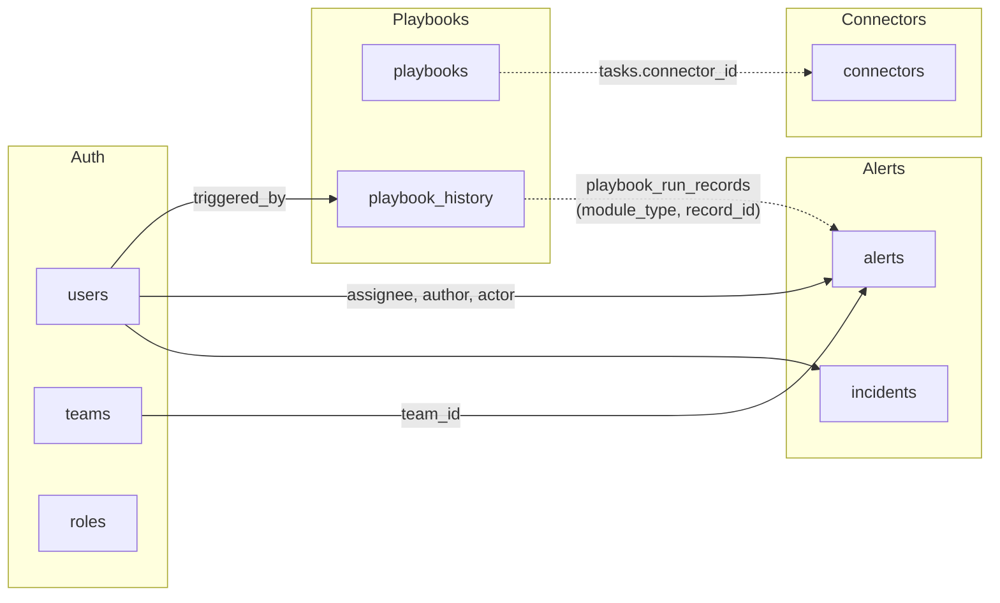
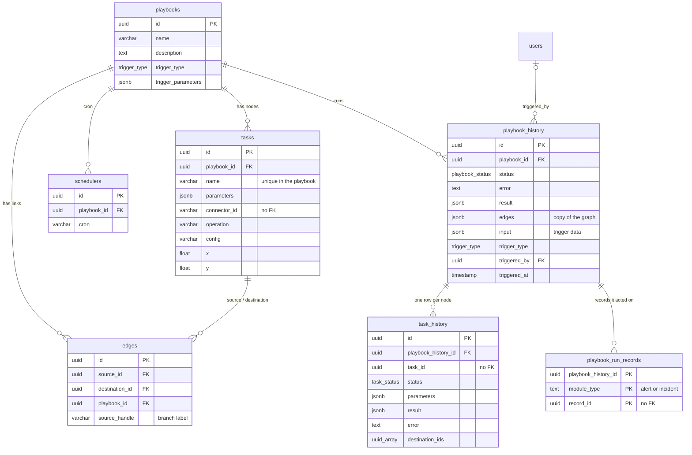
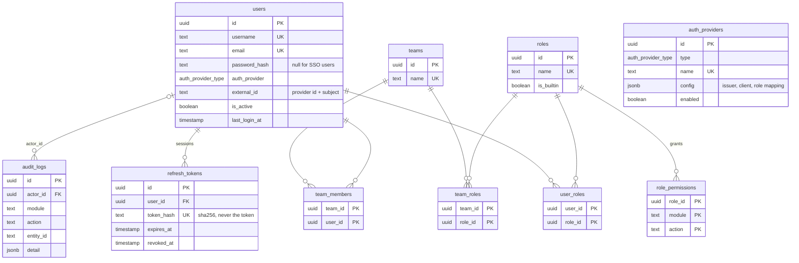
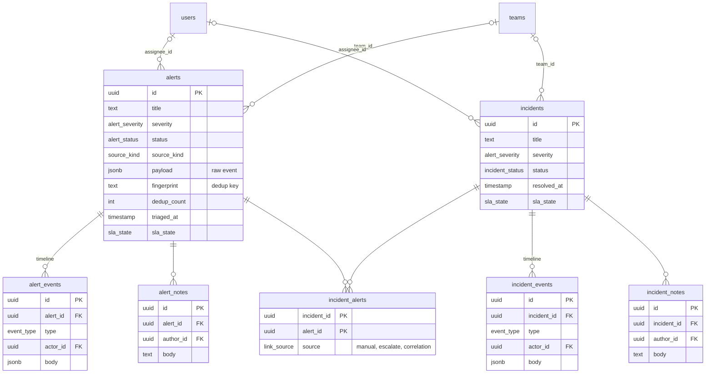
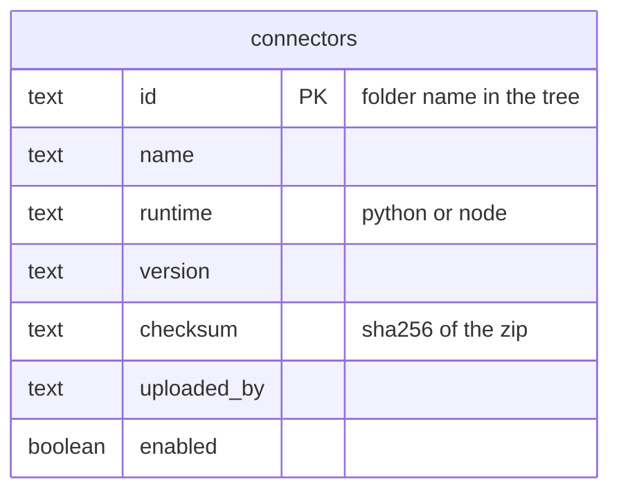

# Database

Postgres is the only data service. This page shows the tables as diagrams. The truth is in `app/ytsoar/db/migrations/`. The SQL queries are in `app/ytsoar/db/queries/`. To change the schema, follow the "Database" section in [CLAUDE.md](../CLAUDE.md).

## 1. Map

There are four groups of tables. Groups link to each other mainly through `users` and `teams`.

A solid line is a foreign key. A dotted line is a link with no foreign key.

## 2. Playbooks and runs

Why this shape:

- **Design vs history.** `playbooks`, `tasks` and `edges` are what the user edits. `playbook_history` and `task_history` are a **snapshot** of one run. They copy the graph and the parameters, so a later edit does not change an old run.
- **The queue holds only the run id.** The worker loads `playbook_history` (edges, input) and `task_history` (task snapshots) and builds the message. See [river-guide.md](river-guide.md).
- **`task_history.task_id` has no foreign key.** The user can delete a task from the design. The history stays.
- **`playbook_run_records`** is a join table. One run can act on many alerts or incidents. `record_id` points to `alerts` or `incidents` by `module_type`, so it has no foreign key.
- **Status rules.** Run: `queued` -> `in_progress` -> `success` or `failed`. Task: `pending` -> `in_progress` -> `success` or `failed`, or `pending` -> `skipped`. The database checks each change. See [diagram/statuses.md](diagram/statuses.md).
- `schedulers` exists, but no program reads it yet.

## 3. Auth

The flow is explained in [auth.md](auth.md).

Notes:

- `module` and `action` are plain text. The allowed values are Go constants (`internal/domain/auth.go`), not an enum.
- `auth_providers` has no foreign key to `users`. A user links to a provider through `external_id` (`<provider id>|<subject>`). The unique index is on `(auth_provider, external_id)`.
- `audit_logs.actor_id` is `ON DELETE SET NULL`. The trail stays when a user goes.

## 4. Alerts and incidents

Notes:

- **Dedup.** The unique partial index `alerts_open_fingerprint_idx` allows one **open** alert for each fingerprint. A repeat adds to `dedup_count` and `last_seen`. After the alert is closed, the same fingerprint can open a new alert.
- **Timeline.** `alert_events` and `incident_events` are the audit trail of each record. They use `clock_timestamp()`, not `NOW()`. `NOW()` is fixed for the whole transaction, so events of one escalation would share a time and sort in a random order.
- **Paging.** Queue indexes end with `id DESC`, for keyset paging on `(created_at, id)`. A batch insert gives many rows the same `created_at`.
- **Open set.** Partial indexes (`alerts_open_idx`, `incidents_open_idx`) keep live counts of open items cheap.
- User, team, actor and author links use `ON DELETE SET NULL`. A deleted user leaves the record.

## 5. Connectors

The table is an **audit row** for uploaded connectors. The folder tree is the truth for what runs. Built-in connectors (`http_request`, `condition`, snippets) have no row. `tasks.connector_id` is the connector folder name. It is text, not a foreign key. See [connector-upload.md](connector-upload.md).

## 6. Enums

| Type | Values |
|---|---|
| `playbook_status` | `queued`, `in_progress`, `success`, `failed` |
| `task_status` | `pending`, `in_progress`, `success`, `failed`, `skipped` |
| `trigger_type` | `manual`, `webhook`, `referenced`, `on_create`, `on_update`, `on_delete` |
| `auth_provider_type` | `local`, `oidc`, `ldap` (no LDAP code yet) |
| `alert_severity` | `critical`, `high`, `medium`, `low` (incidents use it too) |
| `alert_status` | `new`, `investigating`, `resolved`, `falsepos`, `closed` |
| `incident_status` | `open`, `investigating`, `contained`, `resolved`, `closed` |
| `source_kind` | `edr`, `identity`, `email`, `firewall`, `dlp` |
| `event_type` | `created`, `status_changed`, `escalated`, `triage`, `sla`, `correlation`, `attack_tag`, `linked`, `unlinked`, `updated` |
| `link_source` | `manual`, `escalate`, `correlation` |
| `sla_state` | `ok`, `warning`, `breached`, `met` |

When you add an enum value, also add it to `db/enums.sql`. sqlc reads the enums from that file.

## 7. Tables that we do not own

River (the job queue) owns the `river_*` tables. Do not query them and do not edit them. See [river-guide.md](river-guide.md).

## 8. Migrations

| File | What it adds |
|---|---|
| `20260704134500_init.sql` | Playbooks, tasks, edges, history, schedulers |
| `20260706150000_connectors.sql` | `connectors` |
| `20260706160000_task_status_skipped.sql` | `skipped` task status |
| `20260719100000_auth.sql` | Users, roles, teams, sessions, providers, audit, built-in roles |
| `20260725120000_team_roles.sql` | `team_roles` |
| `20260726090000_alerts_incidents.sql` | Alerts, incidents, events, notes, indexes |
| `20260727090000_event_type_updated.sql` | `updated` event type |
| `20260727091000_playbook_run_input.sql` | Run input, `triggered_by`, `playbook_run_records` |
| `20260801090000_playbook_status_queued.sql` | `queued` run status |
| `20260801100000_river.sql` | River tables |
