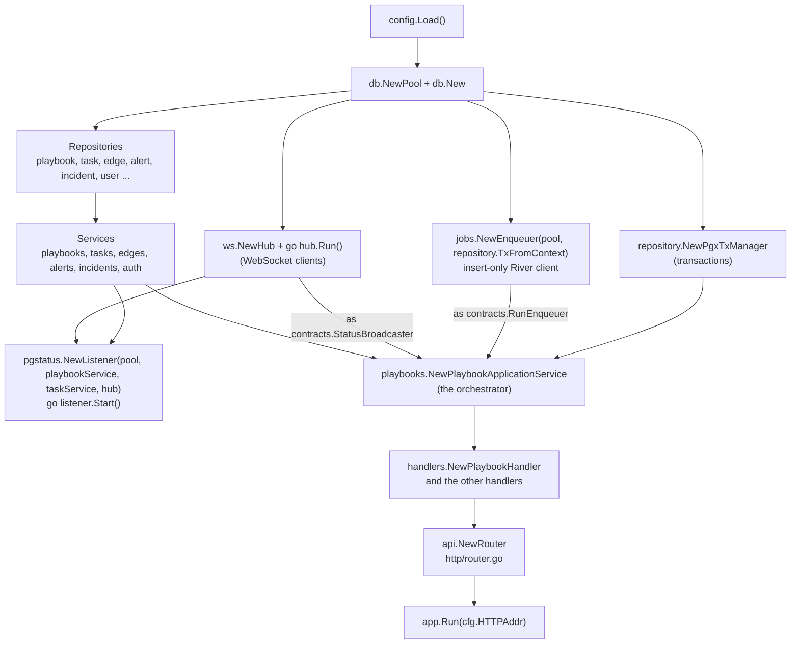

# How the API starts

The API is the program in `app/ytsoar/cmd/api/main.go`. It serves REST and WebSocket. It queues runs. It does not work jobs. File paths are under `app/ytsoar/`.

`main.go` builds each part and passes it to the next one through the constructor. The part that matters for runs is the **enqueuer**. The service gets a port (`RunEnqueuer`). It never sees River.



## Why the enqueuer gets `repository.TxFromContext`

`jobs.Enqueuer` must join the transaction that `PgxTxManager` started, so the job and the history rows commit together. The jobs adapter is not allowed to import the repository adapter. So `main.go` passes the function in:

```go
runEnqueuer, err := jobs.NewEnqueuer(pool, repository.TxFromContext)
```

## What the API does with status events

1. A goroutine runs `pgstatus.Listener.Start`. It holds one dedicated Postgres connection and runs `LISTEN ytsoar_status`.
2. The worker sends `NOTIFY` with an event name and a row ID.
3. The listener loads the row (`GetPlaybookHistoryById` or `GetTaskHistoryById`).
4. The listener calls `hub.Broadcast`. The hub sends the row to all browsers over WebSocket.

If the connection drops, the listener reconnects after a growing delay. A browser that missed an event gets the new status at its next fetch.

## What the API does not do

- It does not work jobs. The worker program does that.
- It does not run playbooks. It only saves them, queues them and shows their status.

## Other parts that start in `main.go`

| Part | Where | Note |
|---|---|---|
| Module events | `jobs.Enqueuer.Publish` | Alerts and incidents queue a `playbook_run_for_event` job in their transaction. The worker starts the playbooks with a matching event trigger. |
| Auth (JWT, OIDC, Argon2) | `application/auth` | Not part of the run flow. |
| Connector store and installer | `adapters/connectorstore`, `adapters/depsinstall` | Serve and install connectors. |
