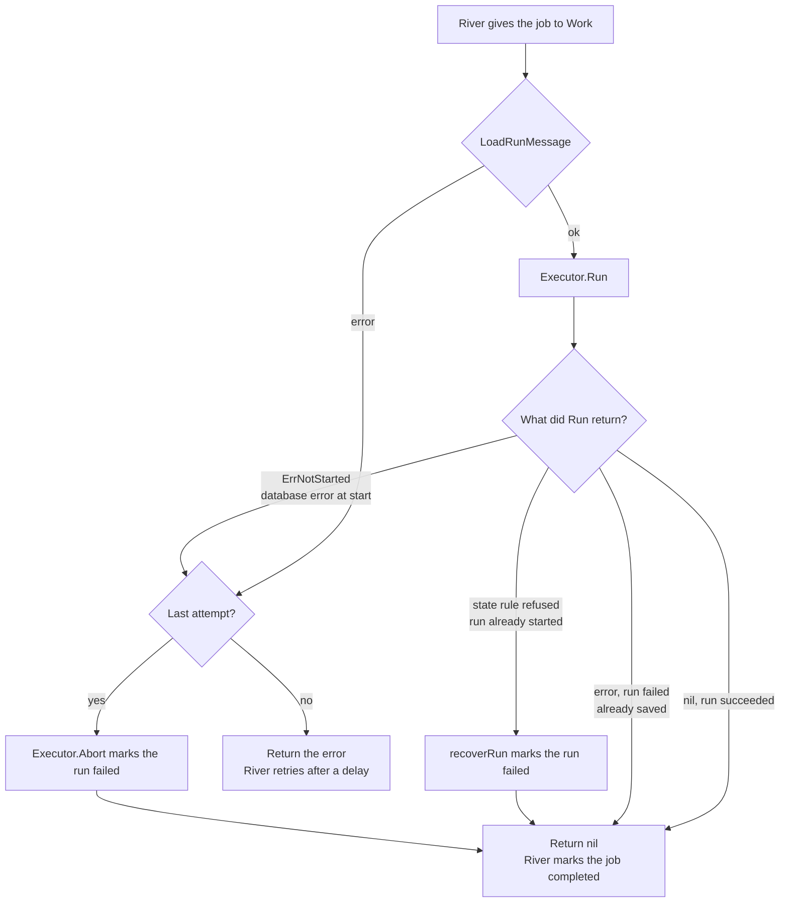

# What the worker does with a job

The worker is `RunWorker.Work` in `internal/adapters/jobs/jobs.go`. It is a thin wrapper. It loads the run, calls the executor and decides what to tell River.

## Why the worker returns nil for a failed run

The executor saves a failed run in the database. If `Work` returned that error, River would retry the job. The connectors would run a second time. So `Work` returns nil.

## Why there are retries

A retry is safe only when nothing ran. Two cases need it:

- The worker could not build the message (for example, a short database error).
- The executor could not start the run (`ErrNotStarted`).

In both cases the run is still `queued`. On the last attempt, `Abort` marks the run `failed`. Without this, the run stays `queued` forever.

## Settings

| Setting | File | Meaning |
|---|---|---|
| `maxAttempts` (5) | `internal/adapters/jobs/jobs.go` | How many times River tries a job. |
| `PLAYBOOK_CONCURRENCY` | `internal/config/config.go` | How many runs one worker runs at the same time. |
| `RUN_TIMEOUT_MINUTES` | `internal/config/config.go` | The time limit for one run (River `JobTimeout`). |
| `rescueGrace` (5 minutes) | `internal/adapters/jobs/jobs.go` | River rescues a `running` job after the run timeout plus this time. |

## River words

- **Kind**: the job name. `RunArgs.Kind()` returns `playbook_run`. River uses it to find the worker.
- **Rescue**: River finds a job that stays `running` too long (the worker died) and sets it to retry.
- **Attempt**: one try of a job. `job.Attempt` counts from 1.
