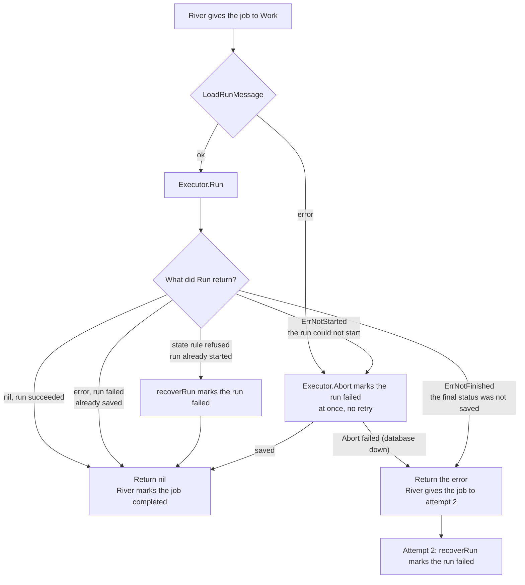

# What the worker does with a job

The worker is `RunWorker.Work` in `internal/adapters/jobs/jobs.go`. It is a thin wrapper. It loads the run, calls the executor and decides what to tell River.

## Why the worker returns nil for a failed run

The executor saves a failed run in the database. If `Work` returned that error, River would retry the job. The connectors would run a second time. So `Work` returns nil.

## A run that cannot start is not retried

"Cannot start" means the worker could not build the message (`LoadRunMessage` failed), or it could not set the run to `in_progress` (`ErrNotStarted`). On attempt 1, nothing ran. The worker calls `Abort` at once. `Abort` marks the run `failed` with the error text, and the user sees the problem right away.

On attempt 2, the first attempt may have run the playbook already (it returned `ErrNotFinished`). So the error text starts with "an earlier attempt did not finish this run". The worker does not call `Abort` when the job context is cancelled (the worker is stopping). River then puts the job back without using an attempt, and a new worker starts the run.

We do not retry for now. A retry hides the problem for several minutes. (The River default policy for 5 attempts waits about 1, 16, 81 and 256 seconds.) It helps only with a short database problem.

If `Abort` also fails (the database is down), `Work` returns that error. River then runs attempt 2, which tries again.

## Why there are 2 attempts

The second attempt is not a retry of a start error. It is for a job that River takes back:

- The worker stopped in the middle of a run. River rescues the job after the run timeout plus 5 minutes. Attempt 2 calls `Run`. The database refuses `queued → in_progress`. `recoverRun` marks the run `failed`.
- The run ran, but the database did not save its final status (`ErrNotFinished`). The executor first tries to save the status again, with waits of 1, 2, 4, 8 and 15 seconds (about 30 seconds). If every try fails, `Work` returns the error. Attempt 2 then marks the run `failed`.

In both cases the connectors do not run a second time.

## Settings

| Setting | File | Meaning |
|---|---|---|
| `maxAttempts` (2) | `internal/adapters/jobs/jobs.go` | How many times River tries a job. The second attempt is only for a job that River takes back. |
| `PLAYBOOK_CONCURRENCY` | `internal/config/config.go` | How many runs one worker runs at the same time. |
| `RUN_TIMEOUT_MINUTES` | `internal/config/config.go` | The time limit for one run (River `JobTimeout`). A value of 0 or less uses the default of 60. |
| `WORKER_STOP_GRACE_SECONDS` (20) | `internal/config/config.go` | When the worker stops, running playbooks get this time to finish. After that, River cancels them, and they are saved as `failed`. |
| `rescueGrace` (5 minutes) | `internal/adapters/jobs/jobs.go` | River rescues a `running` job after the run timeout plus this time. |
| `finalWriteDelays` (about 30 seconds) | `internal/application/execution/executor.go` | The waits between tries to save the final status of a run. |

## River words

- **Kind**: the job name. `RunArgs.Kind()` returns `playbook_run`. River uses it to find the worker.
- **Rescue**: River finds a job that stays `running` too long (the worker died) and sets it to retry.
- **Attempt**: one try of a job. `job.Attempt` counts from 1.
