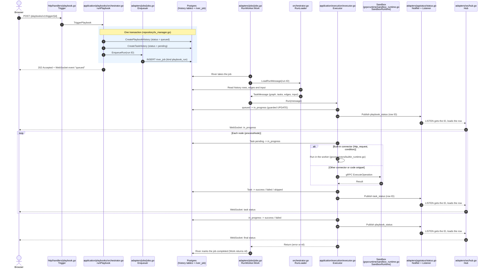

# One playbook run

This page follows one run from the click in the browser to the final status. File paths are under `app/ytsoar/`.

## Step by step, with files

| Step | What happens | File | Function |
|---|---|---|---|
| 1 | The browser calls the trigger route. | `internal/adapters/http/handlers/playbook_routes.go`, `playbook.go` | `Trigger` |
| 2 | The service reads the playbook, its tasks and its edges. | `internal/application/playbooks/orchestrator.go` | `runPlaybook` |
| 3 | The service saves the run as `queued` and the tasks as `pending`. | `internal/adapters/repository/playbook_repository.go`, `task_repository.go` | `CreatePlaybookHistory`, `CreateTaskHistory` |
| 4 | The service queues the job in the same transaction. | `internal/adapters/jobs/jobs.go` | `Enqueuer.EnqueueRun` |
| 5 | The worker process takes the job. | `internal/adapters/jobs/jobs.go` | `RunWorker.Work` |
| 6 | The worker builds the full message from the saved rows. | `internal/application/playbooks/orchestrator.go` | `RunLoader.LoadRunMessage` |
| 7 | The executor moves the run to `in_progress`. | `internal/application/execution/executor.go` | `Run`, `setRunStatus` |
| 8 | The executor runs the nodes in order, and runs independent nodes at the same time. | `internal/application/execution/executor.go` | `processNode` |
| 9 | The resolver picks where a node runs: in the worker or in the sandbox. | `internal/application/execution/resolver.go` | `StaticResolver.Resolve` |
| 10 | Each status change goes to Postgres, then out as an event. | `internal/adapters/pgstatus/status.go` | `Notifier.Publish`, `Listener.forward` |
| 11 | The hub sends the event to the browser. | `internal/adapters/ws/hub.go` | `Hub.Broadcast` |

## Things to know

- The job holds only the run ID. The worker builds the rest from the database (step 6).
- Steps 3 and 4 are one transaction. A run never exists without its job.
- Steps 7 and 8 use guarded `UPDATE` statements. See [statuses.md](statuses.md).
- The browser gets the `queued` event from the API directly (step 4). All other events come from `LISTEN/NOTIFY`.
