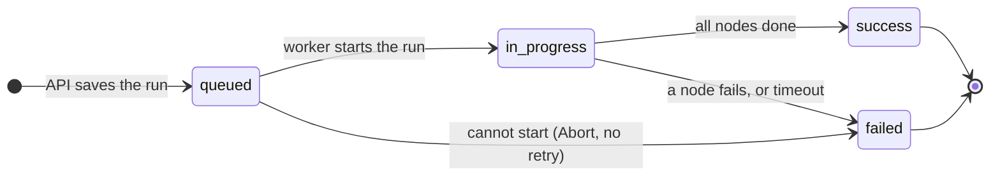
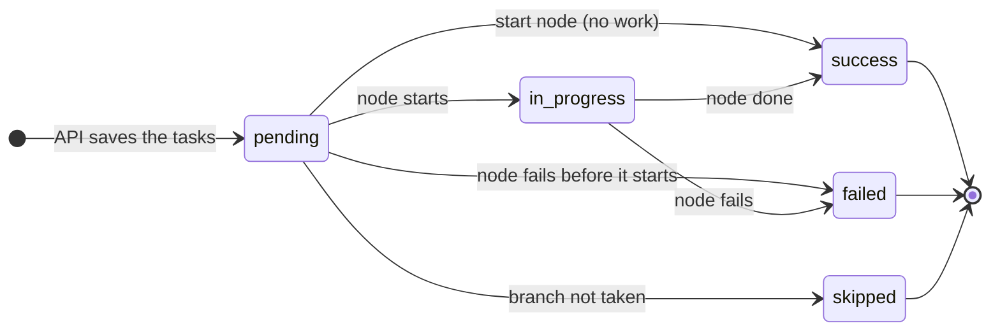
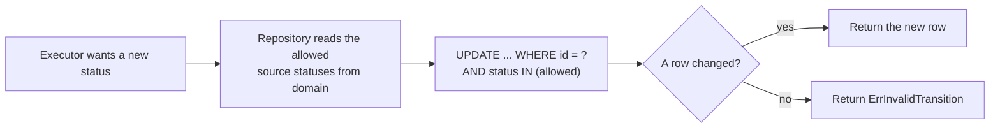

# Run and task statuses

A run and a task each have a status. The database enforces the allowed moves. File paths are under `app/ytsoar/`.

## Run statuses

## Task statuses

## Where the rules are

| Part | File | What to look for |
|---|---|---|
| The allowed moves | `internal/domain/playbook.go` | `RunTransitions`, `TaskTransitions` |
| The check in the database | `db/queries/playbooks.sql`, `db/queries/tasks.sql` | `status::text = ANY(allowed_from)` |
| Passing the rule to the query | `internal/adapters/repository/playbook_repository.go`, `task_repository.go` | `allowedFrom`, `ErrInvalidTransition` |
| The `queued` value | `db/migrations/20260801090000_playbook_status_queued.sql`, `db/enums.sql` | `ADD VALUE 'queued'` |
| The status pill in the UI | `app/frontend/src/components/soar/StatusPill.tsx` | `queued` |

## How a move is checked

Two workers cannot both move the same run from `queued` to `in_progress`. Only one `UPDATE` finds the row in `queued`.

## Crash recovery

A worker can stop in the middle of a run. Then River gives the job to another worker, and this happens:

1. The new worker tries `queued -> in_progress`. The database refuses, because the run is already `in_progress`.
2. The executor calls `recoverRun` (`internal/application/execution/executor.go`).
3. `recoverRun` marks the run `failed` with the message "an earlier attempt started this run and did not finish it (the worker may have stopped)". The text is general, because the cause is not always a stopped worker. For example, the first status change can commit while its reply is lost.
4. It also marks the open tasks `failed` (`FailUnfinishedTaskHistory`), and it sends a `task_status` event for each one, so an open page does not show them as `in_progress`. It does this only after the state rules accepted the change, so a finished run keeps its tasks.
5. The connectors do not run a second time.

If the run is already finished, the executor does nothing.
