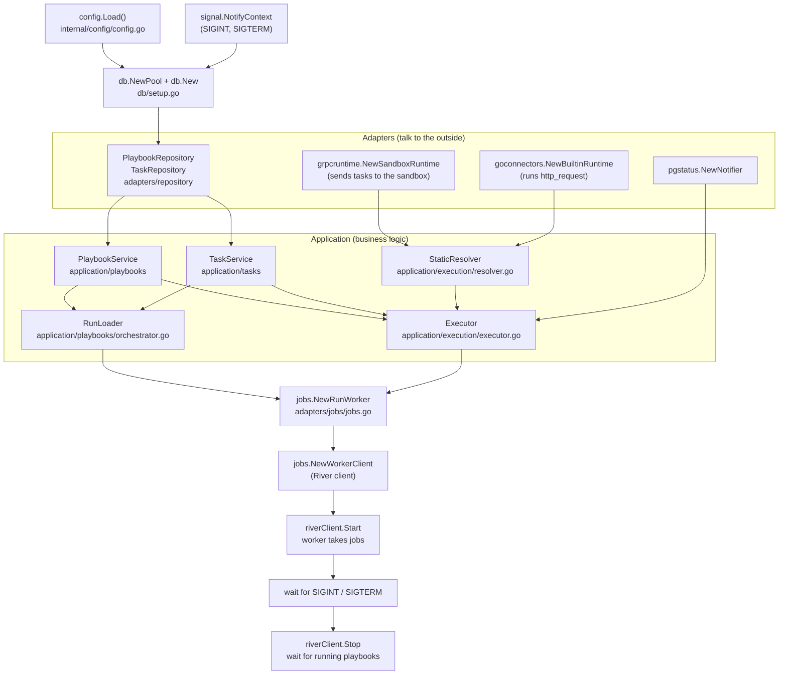

# How the worker starts

The worker is the program in `app/ytsoar/cmd/worker/main.go`. It has no HTTP server. It builds its parts, starts River and waits for a stop signal.

`main.go` connects the parts by hand. It builds each part from the inside out and passes it to the next one through the constructor. There is no DI container.

## Build order, in `main.go`

| # | What `main.go` does | Why |
|---|---|---|
| 1 | `config.Load()` | Read the settings from the environment. |
| 2 | `logger.SetupLogger()` | Make the logger. Every part receives it. |
| 3 | `signal.NotifyContext` | Make a context that ends on SIGINT or SIGTERM. |
| 4 | `db.NewPool`, `db.New` | Open the Postgres pool and the sqlc queries. |
| 5 | `repository.NewPlaybookRepository`, `NewTaskRepositoryImpl` | The adapters that read and write the history tables. |
| 6 | `playbooks.NewPlaybookService`, `tasks.NewTaskServiceImpl` | The services. They get the repositories. |
| 7 | `grpcruntime.NewSandboxRuntime(cfg.SandboxAddr)` | `SandboxRuntime`: it sends tasks to the sandbox over gRPC. The sandbox runs user code. |
| 8 | `goconnectors.NewBuiltinRuntime` and `Register` | `BuiltinRuntime`: the trusted connector that runs in the worker (`http_request`). |
| 9 | `execution.NewStaticResolver(sandbox, byConnector)` | A node with a built-in connector runs in the worker. Every other node goes to the sandbox. |
| 10 | `execution.NewExecutor(...)` | It gets the services, the resolver, the status notifier and the limits. |
| 11 | `playbooks.NewRunLoader(...)`, `jobs.NewRunWorker(...)` | The loader builds the message. The worker calls the loader and the executor. |
| 12 | `jobs.NewWorkerClient(pool, worker, concurrency, runTimeout, stopGrace)` | The River client. It registers the worker for the kind `playbook_run`. |
| 13 | `riverClient.Start(context.Background())` | Start taking jobs. |
| 14 | `<-ctx.Done()` | Wait for a stop signal. |
| 15 | `riverClient.Stop(stopCtx)` | Stop taking jobs. Wait `WORKER_STOP_GRACE_SECONDS` for the running playbooks. After that, River cancels them and they are saved as `failed`. |

## Why River starts with `context.Background()`

A SIGTERM cancels `ctx`. If River used `ctx`, it would cancel the running playbooks at once. `Stop` waits for them instead. The wait is limited to `WORKER_STOP_GRACE_SECONDS` (20 seconds). After that, River cancels the running playbooks, and each one is saved as `failed`. The compose file sets `stop_grace_period: 60s`. Note: in dev, the worker runs under `air`, and we have not checked that `air` passes the stop signal to the worker.

## What the worker does not do

- It does not serve HTTP.
- It does not run user code. It sends it to the sandbox over gRPC.
- It does not listen for status events. Only the API listens (see [api-startup.md](api-startup.md)).

## Settings that the worker reads

| Setting | Default | Meaning |
|---|---|---|
| `DB_*` | none | Postgres connection. |
| `SANDBOX_ADDR` | `localhost:50052` | Where the sandbox listens. |
| `CONNECTORS_DIR` | empty | The folder with the connectors. |
| `MAX_PARALLEL_NODES` | 4 | Nodes that run at the same time in one run. |
| `NODE_TIMEOUT_SECONDS` | 300 | Time limit for one node. |
| `PLAYBOOK_CONCURRENCY` | 1 | Runs that one worker runs at the same time. |
| `RUN_TIMEOUT_MINUTES` | 60 | Time limit for one run. A value of 0 or less uses 60. |
| `WORKER_STOP_GRACE_SECONDS` | 20 | Time that running playbooks get to finish when the worker stops. |
