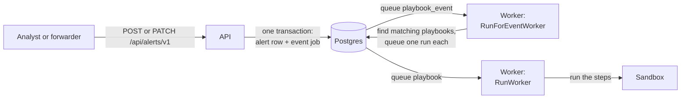
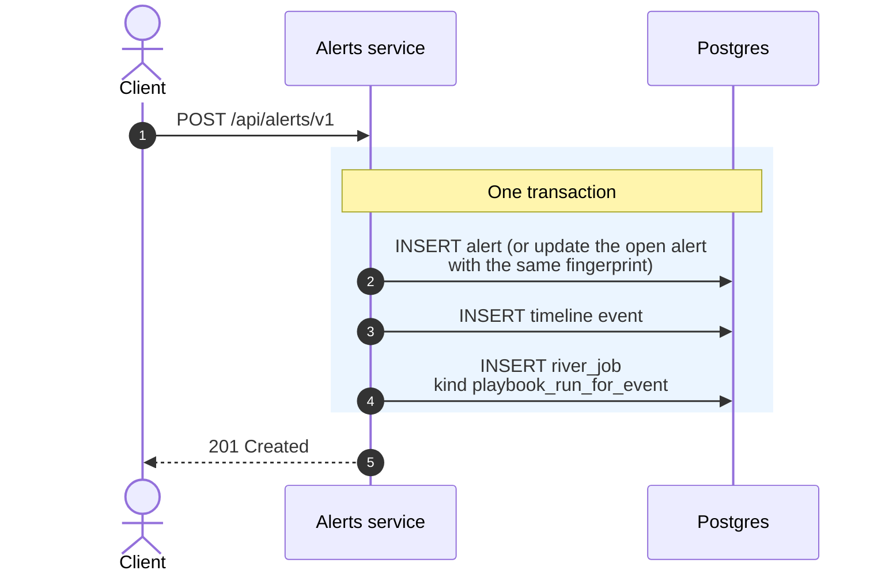
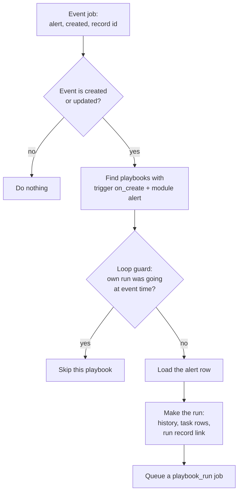
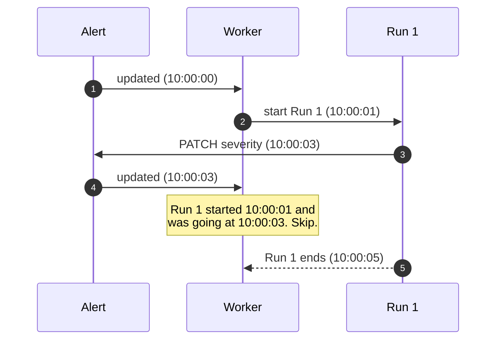

# Event triggers

This page explains how an alert or an incident starts a playbook on its own. It covers the trigger setting, the job that carries the event, how the worker finds the playbooks, and the guard that stops a playbook from starting itself again and again.

## The big picture

| Word | Meaning |
|---|---|
| Event trigger | The trigger type `on_create` or `on_update` on a playbook, with a module (`alert` or `incident`) in `trigger_parameters`. |
| Module event | A change to one alert or one incident: `created` or `updated`. |
| Event job | A River job of kind `playbook_run_for_event`. It holds the module, the event and the record id. Nothing else. |
| Run | One row in `playbook_history`. An event makes one run for each matching playbook. |
| Loop guard | A rule that skips a playbook when its own run on the same record was going at the time of the event. |



There are two jobs. The first job turns the event into runs. The second job is the normal playbook run, the same as a run that you start with the Run button.

## 1. Set the trigger on a playbook

In the playbook editor, open the trigger options. Pick "On create" or "On update" and a module. The editor saves this on the playbook:

```json
{
  "trigger_type": "on_create",
  "trigger_parameters": { "module": "alert" }
}
```

| Trigger type | Starts when |
|---|---|
| `on_create` | A new alert or incident is saved. |
| `on_update` | An alert or incident changes: a PATCH, a status change, an escalation, a link or an unlink. |
| `on_delete` | Nothing yet. The API has no route that deletes an alert or an incident. |

## 2. A change queues an event job

The alerts service and the incidents service call `Publish` at the end of each change. `Publish` inserts the event job in the same transaction as the alert or incident row.



Why in the same transaction:

- If the alert is not saved, the job is not saved. A rollback removes both.
- If the alert is saved, the job is saved too. The event is never lost.

The job holds only ids:

```json
{ "module_type": "alert", "event": "created", "record_id": "e94bd1f8-b581-4d4e-bc47-cff157c76c2b" }
```

A repeat of an open alert (same fingerprint) is an `updated` event, not `created`. So a storm of 500 copies of one alert starts an `on_create` playbook only one time.

## 3. The worker turns the event into runs

The event job goes to its own queue, `playbook_event`. Playbook runs use the queue `playbook`. The worker runs one playbook at a time by default (`PLAYBOOK_CONCURRENCY=1`), so a long run would hold back the events if they shared a queue.

`RunForEventWorker` calls one method, `RunForEvent`. It does this in one transaction:



Each run gets:

| Field | Value |
|---|---|
| `trigger_type` | `on_create` or `on_update` |
| `triggered_by` | empty (no user started it) |
| `input.module_type` | `alert` or `incident` |
| `input.records` | a list with the one record, loaded from the database |
| `input.parameters` | `{}` |

A step reads the record with a template, for example `{{ var.input.records[0].title }}`.

A row in `playbook_run_records` links the run to the record. This is why the run shows in the executions list of the alert or the incident.

All runs of one event are in one transaction. If the job fails, River tries it again (3 attempts in total). A retry cannot make the same runs two times, because a failed attempt saved nothing.

## 4. The loop guard

A playbook can change its own alert. For example, a step sets the severity. That change is an `updated` event. Without a guard, an `on_update` playbook starts again, changes the alert again, and never stops.

The rule: skip a playbook for a record when it has a run on the same record that started before the event and was not finished at the time of the event.



The event time is the time of the change transaction. River saves it as the `created_at` of the job. The guard compares it with two columns of `playbook_history`:

| Column | Set when |
|---|---|
| `triggered_at` | The run is queued. |
| `finished_at` | The run ends as `success` or `failed`. |

A run "was going" at the event time when `triggered_at` is before the event, and the run is still `queued` or `in_progress`, or `finished_at` is after the event. The guard uses the event time, not the time when the worker reads the job. This is important when the change is the last step of a run: the run can end before the worker reads the event job.

## 5. Which changes make which event

| Change | Event |
|---|---|
| POST an alert, new fingerprint | alert `created` |
| POST an alert, same fingerprint as an open alert | alert `updated` |
| PATCH an alert, or change its status | alert `updated` |
| Escalate an alert | incident `created` and alert `updated` |
| POST an incident | incident `created` |
| PATCH an incident, change its status, link or unlink an alert | incident `updated` |

A PATCH that sets the same value as before is still an `updated` event.

## Limits and gotchas

- `on_delete` does nothing. There is no delete route for alerts or incidents.
- A trigger has no conditions yet (for example "only severity high"). Every matching event starts the playbook. A step can check the record and stop early.
- A playbook has no "enabled" switch. To stop event runs, set the trigger back to `manual`.
- The event queue has 1 worker. Many events wait in line. Each event job is short, because it only queues runs.
- Two events for the same record can reach the worker at almost the same time. In rare cases both can start the same playbook.
- Runs from an event do not send a `queued` WebSocket message. The browser sees the run when it becomes `in_progress`.
- Incident events have no integration test of their own. They use the same code as alert events.

## Related docs

- [One playbook run](diagram/run-flow.md): what happens after the run is queued.
- [River guide](river-guide.md): how jobs, queues and attempts work.
- [Ports and interfaces](ports-and-interfaces.md): `ModuleEventPublisher` and `RunEnqueuer`.
- [Statuses](diagram/statuses.md): run and task status rules.
