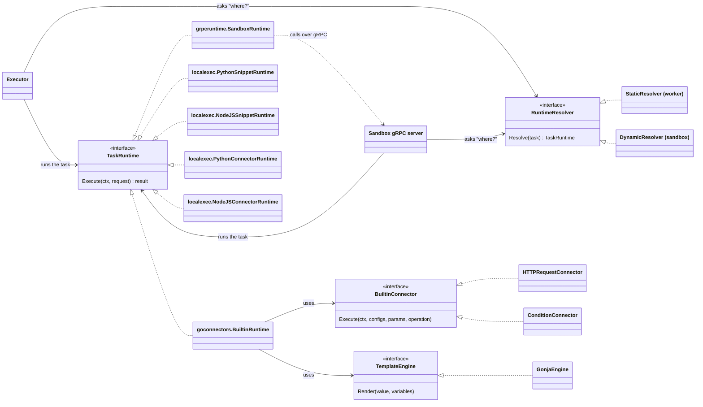
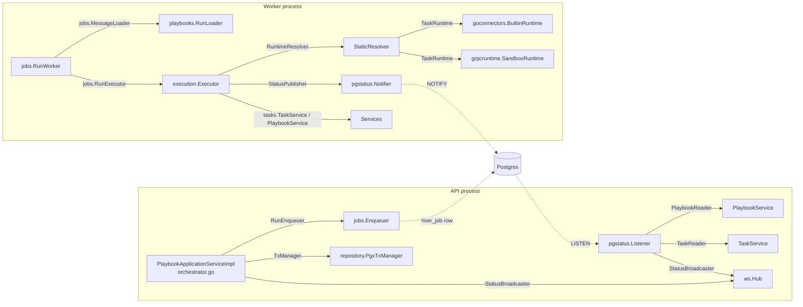

# Ports and interfaces

This guide explains the interfaces in the backend: what they are, why we made them, and who uses them. It starts with the idea. Then it lists each interface that this branch added or changed. File paths are under `app/ytsoar/`.

---

## 1. The idea in five minutes

### Interface

An **interface** in Go is a list of methods. Any type that has these methods fits the interface. You do not write "implements". Go checks it for you.

```go
type Greeter interface{ Greet(name string) string }

type English struct{}
func (English) Greet(name string) string { return "Hello, " + name }

type Spanish struct{}
func (Spanish) Greet(name string) string { return "Hola, " + name }

func welcome(g Greeter) { fmt.Println(g.Greet("Ana")) }   // works with both
```

`welcome` does not know if it gets `English` or `Spanish`. It only knows the method.

### Port and adapter

- A **port** is an interface that the business logic owns. It says "I need this from the outside world".
- An **adapter** is code that fits a port and talks to a real tool (Postgres, River, gRPC, WebSocket).

```
Service  ──▶  Port  ◀──  Adapter  ──▶  Real tool
(logic)     (the socket)  (the plug)    (Postgres, River)
```

Think of a wall socket. The service needs power, so it asks for a socket (the port). The adapter is a plug that fits the socket and connects to the real power station (Postgres, River). You can change the plug. The service does not change.

Example from this repo:

| Part | Name | File |
|---|---|---|
| Business logic | `PlaybookApplicationServiceImpl` | `internal/application/playbooks/orchestrator.go` |
| Port | `contracts.RunEnqueuer` | `internal/application/contracts/contracts.go` |
| Adapter | `jobs.Enqueuer` | `internal/adapters/jobs/jobs.go` |
| Real tool | River and Postgres | |

The service calls `EnqueueRun`. It does not know that River exists.

### Another example: the runtime resolver

`RuntimeResolver` is an interface (a port). It has one method:

```go
type RuntimeResolver interface {
    Resolve(task domain.Tasks) (TaskRuntime, error)
}
```

**In plain words**

- The input is a task (one node of the playbook).
- The output is a **runtime**: the thing that will run that task.
- It is like a receptionist. You say "I have a task that uses the `http_request` connector". The receptionist says "Go to `BuiltinRuntime`, inside the worker."

**How the executor uses it**

```go
runtime, err := resolver.Resolve(task)   // "Where does this task run?"
result, err  := runtime.Execute(...)     // "Run it there."
```

The resolver answers by the connector name:

| Task uses connector | The resolver returns |
|---|---|
| `http_request` | `BuiltinRuntime` (inside the worker) |
| `condition` | `BuiltinRuntime` (inside the worker) |
| `my_python_connector` | `SandboxRuntime` (the sandbox runs it) |

**Three names to keep apart**

| Name | What it is | Meaning |
|---|---|---|
| `RuntimeResolver` | the interface (the port) | "Something that can answer where a task runs." |
| `StaticResolver`, `DynamicResolver` | real types that fit the interface | Two ways to give the answer. |
| `TaskRuntime` | another interface | "Something that can run a task." It is what the resolver returns. |

**Why an interface, and not one fixed function?**

The worker and the sandbox answer the question in different ways:

- The worker uses `StaticResolver`. It has a fixed list.
- The sandbox uses `DynamicResolver`. It checks the disk each time, so a connector that you upload works at once.

The executor does not care which one it has. It only calls `Resolve`. In a test, you give it a fake runtime, and the executor code is the same.

To add a new way to run tasks (for example, in a container), you write one type with `Execute(...)` that ends with `Runtime`, and you return it from the resolver. You do not change `executor.go`.

**Diagram: the interfaces and the types that fit them**

An arrow with a hollow head and a dashed line means "fits the interface". A plain arrow means "uses".



**The same information in a table**

| Interface | Method | Types that fit it | Who uses it |
|---|---|---|---|
| `RuntimeResolver` | `Resolve(task)` | `StaticResolver` (worker), `DynamicResolver` (sandbox) | `Executor`, sandbox gRPC server |
| `TaskRuntime` | `Execute(ctx, request)` | `BuiltinRuntime`, `SandboxRuntime`, `PythonSnippetRuntime`, `NodeJSSnippetRuntime`, `PythonConnectorRuntime`, `NodeJSConnectorRuntime` | `Executor`, sandbox gRPC server |
| `BuiltinConnector` | `Execute(ctx, configs, params, operation)` | `HTTPRequestConnector`, `ConditionConnector` | `BuiltinRuntime` |
| `TemplateEngine` | `Render(value, variables)` | `GonjaEngine` | `BuiltinRuntime` |

**What the worker and the sandbox choose**

| Program | Resolver | Runtimes behind it |
|---|---|---|
| Worker | `StaticResolver` | `BuiltinRuntime` for `http_request` and `condition`. `SandboxRuntime` for everything else. |
| Sandbox | `DynamicResolver` | `PythonSnippetRuntime` and `NodeJSSnippetRuntime` for the code snippets. `NodeJSConnectorRuntime` for JS connectors. `PythonConnectorRuntime` for all other connectors. |

The worker's `SandboxRuntime` calls the sandbox over gRPC. The sandbox then picks one of its own runtimes. So a Python connector passes through two resolvers: first the worker's, then the sandbox's.

The naming rule, the tree and the "where each one runs" diagram are in [runtime-resolver.md](runtime-resolver.md#3-the-names).

---

## 2. Why we use ports

| Reason | What it gives you | Example here |
|---|---|---|
| **Tests** | You replace the real tool with a mock or a fake. No database needed. | `orchestrator_test.go` uses `MockRunEnqueuer`. `jobs_test.go` uses `fakeLoader` and `fakeExecutor`. |
| **Change a tool** | You write a new adapter. The business logic stays the same. | We replaced RabbitMQ with River. The orchestrator changed by a few lines, because it used a port. |
| **Keep libraries out of the logic** | `domain` and `application` do not import pgx, gin or River. They stay simple and stable. | `CLAUDE.md` rule: no third-party client library in `application`. |
| **One direction of dependencies** | `adapters → application → domain`. No import cycles. | The `jobs` adapter imports `execution`. `execution` never imports `jobs`. |

---

## 3. Who owns an interface?

In Go, the **user** of an interface owns it. Define it where you use it, and keep it small. We have two kinds.

### Kind A: a port in `application`

The business logic needs something from outside. It defines the port. An adapter fits it.

- `contracts.RunEnqueuer`, `contracts.TxManager`, `contracts.StatusBroadcaster`
- `execution.TaskRuntime`, `execution.RuntimeResolver`, `execution.StatusPublisher`
- The repository interfaces, for example `tasks.TaskRepository`

### Kind B: a small interface inside an adapter

An adapter needs one or two methods from another part. It defines a small interface for exactly those methods. `main.go` gives it the real object.

- `jobs.MessageLoader` and `jobs.RunExecutor`
- `pgstatus.PlaybookReader` and `pgstatus.TaskReader`

Why not use the real type? Three reasons:

1. **Small.** `PlaybookService` has about 15 methods. The status listener needs one. A small interface says exactly what it uses.
2. **Easy to test.** A test writes a fake with one method.
3. **Less coupling.** The adapter does not depend on a big type.

---

## 4. Map: the interfaces in the run path



Read each arrow as "uses the interface named on the arrow; the box at the end fits it".

---

## 5. What this branch added or changed

### 5.1 `contracts.RunEnqueuer` (new, replaced `TaskPublisher`)

```go
type RunEnqueuer interface {
    EnqueueRun(ctx context.Context, playbookHistoryID uuid.UUID) error
}
```

- **File:** `internal/application/contracts/contracts.go`
- **Used by:** `PlaybookApplicationServiceImpl.runPlaybook`
- **Fitted by:** `jobs.Enqueuer` (`internal/adapters/jobs/jobs.go`)
- **Why we made it:** The old port was `TaskPublisher.SendMessage(message any)`. It had two problems. It took `any`, so nothing said what to send. It had no `ctx`, so it could not join a database transaction. The new port takes the run ID and a `ctx`. The `ctx` carries the transaction, so the job and the history rows commit together.
- **Why only an ID:** The queue holds a small reference. The data stays in the database.
- **How it is tested:** `orchestrator_test.go` expects `EnqueueRun` inside the transaction. If it returns an error, the whole call fails and there is no broadcast.

### 5.2 `jobs.MessageLoader` (new, Kind B)

```go
type MessageLoader interface {
    LoadRunMessage(ctx context.Context, playbookHistoryID uuid.UUID) (domain.TaskMessage, error)
}
```

- **File:** `internal/adapters/jobs/jobs.go`
- **Used by:** `jobs.RunWorker.Work`
- **Fitted by:** `playbooks.RunLoader` (`internal/application/playbooks/orchestrator.go`)
- **Why we made it:** The job holds only the run ID. Someone must build the full message from the database. That code belongs in the application layer (it knows the domain types). The job worker only needs the one method. `jobs_test.go` uses `fakeLoader`.
- **Note:** The interface is called `MessageLoader`, and the struct that fits it is called `playbooks.RunLoader`. We gave them different names, so a reader does not mix them up.

### 5.3 `jobs.RunExecutor` (new, Kind B)

```go
type RunExecutor interface {
    Run(ctx context.Context, msg domain.TaskMessage) error
    Abort(ctx context.Context, playbookHistoryID uuid.UUID, cause error) error
}
```

- **File:** `internal/adapters/jobs/jobs.go`
- **Used by:** `jobs.RunWorker.Work`
- **Fitted by:** `execution.Executor`
- **Why we made it:** The worker is a thin wrapper that calls two methods. The interface lists exactly these two. A test uses `fakeExecutor` to check what `Work` does for each result (success, failed run, `ErrNotStarted`, `ErrNotFinished`, a failed `Abort`) with no real executor.

### 5.4 `execution.StatusPublisher` (changed)

```go
type StatusPublisher interface {
    Publish(ctx context.Context, event string, id uuid.UUID) error
}
```

- **File:** `internal/application/execution/ports.go`
- **Used by:** `execution.Executor` (after each status change)
- **Fitted by:** `pgstatus.Notifier` (it runs `pg_notify`)
- **What changed:** Before, it was `Publish(event string, data any)`, and RabbitMQ carried the whole row. Now it takes `ctx` and the row ID. A Postgres `NOTIFY` is limited to 8000 bytes, and a task result can be larger. The API loads the row from the ID.

### 5.5 `pgstatus.PlaybookReader` and `pgstatus.TaskReader` (new, Kind B)

```go
type PlaybookReader interface {
    GetPlaybookHistoryById(ctx context.Context, id uuid.UUID) (*domain.PlaybookHistoryResponse, error)
}
type TaskReader interface {
    GetTaskHistoryById(ctx context.Context, id uuid.UUID) (*domain.TaskHistory, error)
}
```

- **File:** `internal/adapters/pgstatus/status.go`
- **Used by:** `pgstatus.Listener.forward`
- **Fitted by:** `PlaybookService` and `TaskService`
- **Why we made them:** The listener loads one row for each event. It does not need the other methods of the services. `status_test.go` uses one small fake for both.

### 5.6 `txFrom func(context.Context) (pgx.Tx, bool)` (a function, not an interface)

```go
runEnqueuer, err := jobs.NewEnqueuer(pool, repository.TxFromContext)
```

- **File:** `internal/adapters/jobs/jobs.go`, wired in `cmd/api/main.go`
- **Why:** `jobs.Enqueuer` must join the transaction that `PgxTxManager` started. But an adapter must not import another adapter. So `main.go` passes the lookup function in. A function with one job needs no interface.

### 5.7 What we did not change

`contracts.ModuleEventPublisher` stays. `jobs.Enqueuer` implements it: the alerts and incidents services call it in their transaction, and it queues a `playbook_run_for_event` job. The worker calls `RunForEvent`, which queues one run for each playbook with a matching `on_create` or `on_update` trigger.

---

## 6. Older interfaces in the run path

| Interface | File | Fitted by | Why it exists |
|---|---|---|---|
| `execution.TaskRuntime` | `execution/ports.go` | `BuiltinRuntime`, `SandboxRuntime`, and the four `localexec` runtimes | The executor runs any node the same way. It does not know if the node runs in the worker or in the sandbox. |
| `execution.RuntimeResolver` | `execution/ports.go` | `StaticResolver` (worker), `DynamicResolver` (sandbox) | The executor asks "where does this node run?". See [runtime-resolver.md](runtime-resolver.md). |
| `contracts.TxManager` | `contracts/contracts.go` | `repository.PgxTxManager` | Services use a transaction without a pgx import. |
| `contracts.StatusBroadcaster` | `contracts/contracts.go` | `ws.Hub` | The service sends a message to the browsers without a WebSocket library. |
| `tasks.TaskRepository`, `playbooks.PlaybookRepository`, `edges.EdgeRepository` | `application/*/ports.go` | `repository/*_repository.go` | Services read and write data without SQL or pgx types. |
| `goconnectors.BuiltinConnector`, `goconnectors.TemplateEngine` | `goconnectors/builtin_runtime.go` | `HTTPRequestConnector`, `ConditionConnector`, `GonjaEngine` | The registry runs any built-in connector and any template engine. |

---

## 7. Two examples

### Example 1: test a service with no database

```go
// orchestrator_test.go (short form)
env.mockEnqueuer.EXPECT().
    EnqueueRun(gomock.Any(), historyID).
    Return(fmt.Errorf("queue error"))

_, err := env.service.TriggerPlaybook(ctx, playbookID)
assert.Error(t, err)            // the whole trigger fails, no run is lost
```

The real River client is not used. The mock is made by `mockgen` from the `//go:generate` line above the port.

### Example 2: change the queue again

Suppose you want to use another queue. You:

1. Write a new type with `EnqueueRun(ctx, id) error`.
2. Pass it to `NewPlaybookApplicationService` in `cmd/api/main.go`.

You do not change `orchestrator.go`. The compiler checks that the new type fits the port.

---

## 8. How to add a port (checklist)

1. **Name what the logic needs**, not what the tool does. `RunEnqueuer`, not `RiverClient`.
2. **Keep it small.** Only the methods that the user calls.
3. **Use domain types and `context.Context`.** No pgx, gin or River types. No `any` if you can name the type.
4. **Put it where it is used:** `application/contracts` or `application/<area>/ports.go`, or a small interface inside the adapter (Kind B).
5. **Add the `//go:generate mockgen` line** above it, then run `go generate ./...`.
6. **Write the adapter** and convert the library types to domain types inside it.
7. **Wire it in `main.go`.** Pass it through the constructor.
8. **Test the user** with the mock. Test the adapter with a real database if it has SQL (`TEST_DATABASE_URL`).

---

## 9. Things to question

Good design asks hard questions. These are open points in the code:

- **`any` in some ports.** `StatusBroadcaster.Broadcast(data any)` uses `any`. Callers can pass anything. A named type would be safer.
- **No compile-time check.** The compiler checks that `jobs.Enqueuer` fits `RunEnqueuer` only where `main.go` passes it. A line such as `var _ contracts.RunEnqueuer = (*Enqueuer)(nil)` would check it in the adapter file.
- **Names.** We renamed the old runtime types so every `TaskRuntime` ends with `Runtime`, and every resolver ends with `Resolver`. Check that a new type follows the same rule.
- **Too many interfaces?** An interface is a cost. Make one when you have a second implementation, a test fake, or a rule that blocks an import. Do not make one only because a rule says so.
- **`jobs` imports `execution`.** This is allowed (adapter → application). It is for the `ErrNotStarted` value. Check that you are happy with this link.
