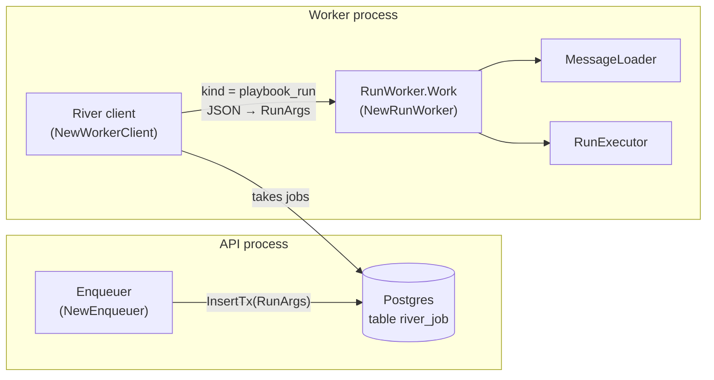
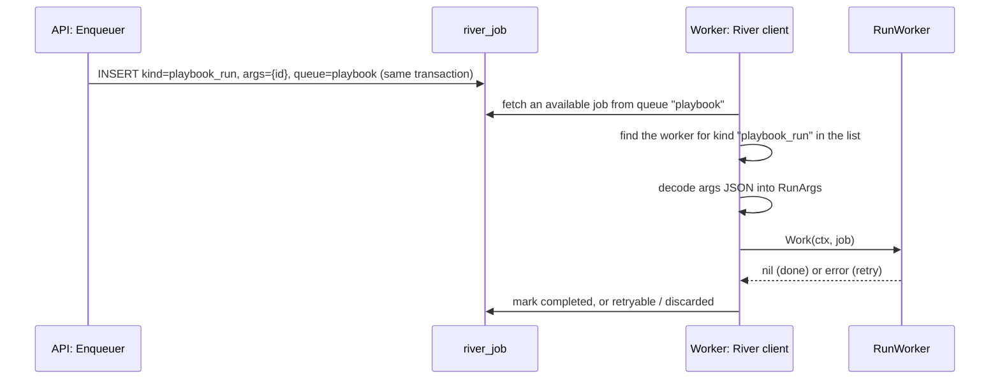
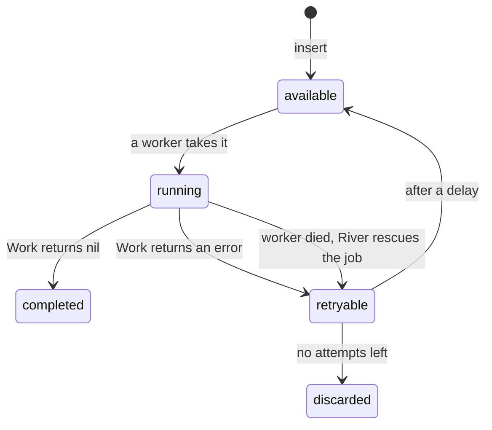

# River guide: how jobs work in this repo

River is a job queue. It stores the jobs in Postgres (the table `river_job`). This guide explains each piece in `app/ytsoar/internal/adapters/jobs/jobs.go`. It starts with the pieces and ends with one job from start to end.

For the first steps of River in general, see section 7 at the end.

## 1. The pieces and how they connect



| Piece | What it is | Runs in |
|---|---|---|
| `RunArgs` | The data and the name of one job. | Both |
| `Enqueuer` | Adds a job to the queue. | API |
| `river_job` | The Postgres table that holds the jobs. | Postgres |
| River client (worker) | Takes jobs from the table and calls the worker. | Worker |
| `RunWorker` | The code that does one job. | Worker |
| `MessageLoader`, `RunExecutor` | The two things that `RunWorker` calls. | Worker |

## 2. `RunArgs`: the data of one job

```go
type RunArgs struct {
    PlaybookHistoryID uuid.UUID `json:"playbook_history_id"`
}
func (RunArgs) Kind() string { return "playbook_run" }
func (RunArgs) InsertOpts() river.InsertOpts {
    return river.InsertOpts{Queue: queueName, MaxAttempts: maxAttempts}
}
```

- **The struct** is what River saves in the `args` column as JSON. The `json` tag sets the key name. The saved row is `{"playbook_history_id": "0134..."}`.
- **Why only the ID:** the table stays small. The worker loads the rest from the history tables.
- **`Kind()`** is the job name. River saves it in the `kind` column. River uses this name later to find the worker. This is the link between the API and the worker.
- **`InsertOpts()`** gives default settings for every job of this type: the queue name `playbook`, and a maximum of 5 attempts. You write them one time here, and not at each insert.

A row in `river_job` looks like this:

| kind | args | queue | state | max_attempts |
|---|---|---|---|---|
| `playbook_run` | `{"playbook_history_id": "0134..."}` | `playbook` | `available` | 5 |

## 3. `RunWorker`: the code that does the job

```go
type RunWorker struct {
    river.WorkerDefaults[RunArgs]   // 1
    logger   logger.Logger          // 2
    loader   MessageLoader
    executor RunExecutor
}
```

1. **`river.WorkerDefaults[RunArgs]`** does two things.
   - It gives default versions of the optional River methods (for example, the retry delay and the timeout). You write only `Work`.
   - The `[RunArgs]` links this worker to the args type. River reads the kind (`playbook_run`) from `RunArgs`. So River knows "jobs of kind `playbook_run` go to `RunWorker`".
2. **The other fields** are what the worker needs: a logger, something that builds the message (`MessageLoader`), and something that runs it (`RunExecutor`). They are interfaces, so tests use fakes. See [ports-and-interfaces.md](ports-and-interfaces.md).

## 4. `NewRunWorker`: a constructor

```go
func NewRunWorker(log logger.Logger, loader MessageLoader, executor RunExecutor) *RunWorker {
    return &RunWorker{logger: log, loader: loader, executor: executor}
}
```

It does nothing special. `main.go` calls it with the real loader and the real executor. This is dependency injection by hand. A test calls it with `fakeLoader` and `fakeExecutor` (see `jobs_test.go`).

## 5. `Work`: what happens for one job

```go
func (w *RunWorker) Work(ctx context.Context, job *river.Job[RunArgs]) error {
    id := job.Args.PlaybookHistoryID               // River already decoded the JSON into RunArgs
    msg, err := w.loader.LoadRunMessage(ctx, id)   // build the full message
    ...
    err = w.executor.Run(ctx, msg)                 // run it
    ...
    return nil                                     // nil = completed, an error = River retries
}
```

- `job.Args` is a `RunArgs` that River made from the JSON.
- `job.Attempt` and `job.MaxAttempts` tell the worker which try this is.
- What `Work` returns decides what River does next. See [diagram/job-results.md](diagram/job-results.md).

## 6. `NewWorkerClient` and `NewEnqueuer`

### The worker side: `NewWorkerClient`

```go
workers := river.NewWorkers()              // an empty list of workers
river.AddWorker(workers, worker)           // add RunWorker to the list, under kind "playbook_run"
return river.NewClient(riverpgxv5.New(pool), &river.Config{
    Queues:  {"playbook": {MaxWorkers: concurrency}},  // take jobs from this queue, N at a time
    Workers: workers,                                  // the list above
    JobTimeout:           runTimeout,                  // time limit for one job
    RescueStuckJobsAfter: runTimeout + rescueGrace,    // take back a job whose worker died
})
```

| Setting | Meaning |
|---|---|
| `riverpgxv5.New(pool)` | The driver. It tells River to use Postgres through pgx. |
| `Queues` | Which queue to read, and how many jobs to run at the same time (`PLAYBOOK_CONCURRENCY`). A job in a queue that is not listed here is ignored. |
| `Workers` | The list that River searches by kind. |
| `JobTimeout` | The time limit for one job (`RUN_TIMEOUT_MINUTES`). |
| `RescueStuckJobsAfter` | A job that stays `running` longer than this is given back to the queue. It must be longer than `JobTimeout`. |

`main.go` calls `Start()` on this client. From then on, River runs a loop: fetch an `available` job, find the worker by kind, decode the JSON, call `Work`.

### The API side: `NewEnqueuer`

```go
river.NewClient(riverpgxv5.New(pool), &river.Config{})   // no Queues, no Workers
```

It is a client that can only add jobs (insert-only). It has no workers, so it never takes a job. `EnqueueRun` calls `InsertTx(ctx, tx, RunArgs{...}, nil)`. The `tx` is the same database transaction that saved the run, so the run and the job commit together. If the transaction rolls back, the job disappears too.

`NewEnqueuer` gets a function (`txFrom`) from `main.go` to find that transaction. The jobs adapter is not allowed to import the repository adapter.

## One job, from start to end



## How a job changes state



## 7. River in general (a small example)

The same four parts, with an email job as the example:

```go
// 1. Args: the data and the name of the job
type EmailArgs struct{ UserID int }
func (EmailArgs) Kind() string { return "send_email" }

// 2. Worker: the code that does the job
type EmailWorker struct{ river.WorkerDefaults[EmailArgs] }
func (w *EmailWorker) Work(ctx context.Context, job *river.Job[EmailArgs]) error {
    return sendEmail(job.Args.UserID) // return an error = River retries the job
}

// 3. Add a job (in a transaction) ...
client.InsertTx(ctx, tx, EmailArgs{UserID: 7}, nil)

// 4. ... and work jobs in another process
workers := river.NewWorkers()
river.AddWorker(workers, &EmailWorker{})
client, _ := river.NewClient(riverpgxv5.New(pool), &river.Config{
    Queues:  map[string]river.QueueConfig{river.QueueDefault: {MaxWorkers: 5}},
    Workers: workers,
})
client.Start(ctx)
```

**How does `InsertTx` know to call `EmailWorker`?** By the kind. `EmailArgs.Kind()` returns `"send_email"`. River saves this in the `kind` column. `AddWorker` reads the kind from the args type of the worker. The worker process finds the right worker with this name.

**If a kind has no worker:** the attempt fails and River retries it. After the last attempt, the job is `discarded`. So the kind must be the same in the process that adds the job and in the process that works it.

## 8. Where to look

| What | File |
|---|---|
| `RunArgs`, `RunWorker`, `Enqueuer`, `NewWorkerClient` | `internal/adapters/jobs/jobs.go` |
| The tests (fakes for the loader and the executor) | `internal/adapters/jobs/jobs_test.go` |
| Where the API queues a run, in the transaction | `internal/application/playbooks/orchestrator.go` (`runPlaybook`) |
| Where the worker builds and starts the River client | `cmd/worker/main.go` |
| Where the API builds the enqueuer | `cmd/api/main.go` |
| The River tables | `db/migrations/20260801100000_river.sql` (made by River, do not edit) |
