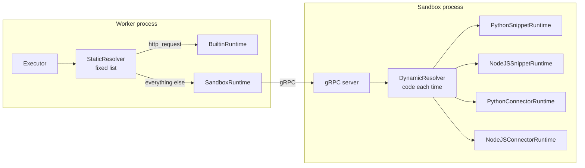

# Runtime resolver

A playbook task must run somewhere. The **runtime resolver** decides where. This page explains the idea, the names, and where each part runs. File paths are under `app/ytsoar/`.

## 1. The problem

A playbook has nodes. Each node is a **task** that uses a connector, for example `http_request` or `my_python_connector`. The executor must pick the code that runs the task:

- A built-in connector (`http_request`) runs inside the worker.
- A Python connector (this includes `condition`), a JavaScript connector or a code snippet runs in the sandbox.

The executor does not want to know these details. It asks one question: "Which runtime runs this task?"

## 2. The two ports

A **port** is a small Go interface. Both are in `internal/application/execution/ports.go`.

```go
// "Which runtime runs this task?"
type RuntimeResolver interface {
    Resolve(task domain.Tasks) (TaskRuntime, error)
}

// "Run this task."
type TaskRuntime interface {
    Execute(ctx context.Context, req ExecutionRequest) (json.RawMessage, error)
}
```

The code that uses them has two lines (`processNode` in `executor.go`):

```go
runtime, err := e.resolver.Resolve(task)   // 1. ask where it runs
raw, err := runtime.Execute(ctx, request)  // 2. run it
```

## 3. The names

### The rule

1. A type that answers "where does this task run?" ends with `Resolver`.
2. A type that runs a task ends with `Runtime`.
3. The name says what the type runs: `Builtin`, `Sandbox`, `Python`, `NodeJS`.
4. "Node" is not used for Node.js. It is `NodeJS`. (A playbook node is a "task" in the code.)

### Ports

| Port | Question it answers |
|---|---|
| `RuntimeResolver` | Which runtime runs this task? |
| `TaskRuntime` | Run this task. |

### Types that fit `RuntimeResolver`

| Type | How it decides | Where it runs |
|---|---|---|
| `StaticResolver` | From a fixed list, made at start-up | Worker |
| `DynamicResolver` | By running your code each time | Sandbox (behind gRPC) |

### Types that fit `TaskRuntime`

| Type | What it runs | Where it runs |
|---|---|---|
| `goconnectors.BuiltinRuntime` | The built-in connectors | Worker |
| `grpcruntime.SandboxRuntime` | Sends the task to the sandbox | Worker, calls the sandbox over gRPC |
| `localexec.PythonSnippetRuntime` | A Python code snippet | Sandbox |
| `localexec.NodeJSSnippetRuntime` | A JavaScript code snippet | Sandbox |
| `localexec.PythonConnectorRuntime` | A Python connector | Sandbox |
| `localexec.NodeJSConnectorRuntime` | A JavaScript connector | Sandbox |

### Other names

| Name | What it is |
|---|---|
| `goconnectors.BuiltinConnector` | The interface of one built-in connector (`HTTPRequestConnector`). Not the same as `TaskRuntime`. |
| `jobs.MessageLoader` | The interface that the job worker uses to build the message of a run. The struct `playbooks.RunLoader` fits it. |
| `localexec.IsNodeJSConnector` | Reads `info.json` and says if a connector runs on Node.js. |

### The tree

```
Executor (a struct, the main service)
├── RuntimeResolver (port)   "which runtime runs this task?"
│   ├── StaticResolver        fixed list       (WORKER)
│   │    ├── default:  SandboxRuntime
│   │    └── list:     BuiltinRuntime
│   │                    ├── BuiltinConnector: HTTPRequest
│   │                    └── TemplateEngine:   GonjaEngine
│   └── DynamicResolver       code each time   (SANDBOX, behind gRPC)
│        ├── PythonSnippetRuntime,  NodeJSSnippetRuntime
│        └── PythonConnectorRuntime, NodeJSConnectorRuntime
└── TaskRuntime (port)   "run this task"  ← every "...Runtime" type above fits it
```

`Executor` is a struct, not an interface. It **uses** the two ports.

### Where each one runs



A Python connector passes through two resolvers. First the worker's `StaticResolver` returns `SandboxRuntime`. `SandboxRuntime` calls the sandbox over gRPC. Then the sandbox's `DynamicResolver` returns `PythonConnectorRuntime`.

## 4. Two ways to build a resolver

### `StaticResolver`: a fixed list

It has a map from connector ID to runtime, and one default. The worker builds it one time at start-up (`cmd/worker/main.go`).

```go
resolver := execution.NewStaticResolver(
    sandboxRuntime,                          // default: send to the sandbox
    map[string]execution.TaskRuntime{        // exceptions: run in the worker
        "http_request": builtinRuntime,
    },
)
```

| Connector ID of the task | Where it runs |
|---|---|
| `http_request` | In the worker |
| `condition` | The sandbox (a Python connector) |
| `my_python_connector` | The sandbox (the default) |
| `anything_else` | The sandbox (the default) |

The list does not change while the program runs. This is fine for the worker, because the built-in connectors are fixed.

### `DynamicResolver`: your code, each time

The sandbox needs a rule that can change while it runs. A user can upload a new connector, and it must work on the next run with no restart. A fixed list cannot do this. So the sandbox writes the rule as a function (`cmd/sandbox/main.go`):

```go
resolver := execution.DynamicResolver(func(task domain.Tasks) (execution.TaskRuntime, error) {
    if task.ConnectorID != nil {
        if runtime, ok := byConnector[*task.ConnectorID]; ok {
            return runtime, nil                       // code snippets
        }
        if localexec.IsNodeJSConnector(dir, *task.ConnectorID) {
            return nodeJSConnectorRuntime, nil        // reads info.json now
        }
    }
    return defaultRuntime, nil                        // Python connectors
})
```

| Connector ID of the task | Where it runs |
|---|---|
| `code_snippet_py` | `PythonSnippetRuntime` |
| `code_snippet_js` | `NodeJSSnippetRuntime` |
| A connector with `"runtime": "node"` in its `info.json` | `NodeJSConnectorRuntime` |
| Any other connector | `PythonConnectorRuntime` (the default) |

`IsNodeJSConnector` reads `info.json` from the disk each time. A connector that you upload after the sandbox started works at once.

### The difference, side by side

| | `StaticResolver` | `DynamicResolver` |
|---|---|---|
| The decision | A lookup in a list | Any code you write |
| When it decides | From a list made at start-up | Each time, with fresh data |
| Used by | The worker | The sandbox |
| Why | The built-in connectors never change | Uploaded connectors must work with no restart |

## 5. What is `DynamicResolver` in Go?

It is a **function type** with a method. It turns a plain function into something that fits the interface.

```go
type DynamicResolver func(task domain.Tasks) (TaskRuntime, error)

func (f DynamicResolver) Resolve(task domain.Tasks) (TaskRuntime, error) {
    return f(task)   // call the function itself
}
```

Without it, you would write a struct only to hold one function. With it, you write the rule as a function and wrap it. The Go standard library does the same: `http.HandlerFunc` turns a function into an `http.Handler`.

### A small example you can run

```go
package main

import "fmt"

// The port
type Greeter interface{ Greet(name string) string }

// The function type that fits the port
type GreeterFunc func(name string) string

func (f GreeterFunc) Greet(name string) string { return f(name) }

func main() {
    var g Greeter = GreeterFunc(func(name string) string {
        return "Hello, " + name
    })
    fmt.Println(g.Greet("Ana")) // Hello, Ana
}
```

`GreeterFunc` is to `Greeter` what `DynamicResolver` is to `RuntimeResolver`.

## 6. The comments in the code

Each type has a comment that says what it is and where it runs.

```go
// StaticResolver chooses a runtime from a fixed list that is made at start-up.
// It runs in the WORKER. The list holds the built-in connectors (http_request),
// which run inside the worker (BuiltinRuntime). Every other
// connector goes to the default runtime, SandboxRuntime, which sends the task
// to the sandbox over gRPC.
type StaticResolver struct { ... }

// DynamicResolver chooses a runtime by calling your function each time a task arrives.
// It runs in the SANDBOX, behind the gRPC server. The worker's SandboxRuntime calls the
// sandbox over gRPC, and then this resolver picks the runtime that runs the task.
// The function reads info.json from the disk on every call, so a connector that you
// upload works with no restart.
type DynamicResolver func(task domain.Tasks) (TaskRuntime, error)
```

Both ports and all six runtimes have a comment of the same kind.

## 7. Why this is good design

- The executor depends on a port. It does not know about the sandbox, gRPC or `info.json`. This follows the architecture rules in `CLAUDE.md`.
- The worker and the sandbox use the same ports with different resolvers.
- A test passes a mock runtime (`MockTaskRuntime` in `execution/mocks`).
- To add a new way to run tasks (for example, in a container), you write one type with `Execute(...)` that ends with `Runtime`, and you return it from a resolver. You do not change `executor.go`.

## 8. Where to look

| What | File |
|---|---|
| The `RuntimeResolver` and `TaskRuntime` ports | `internal/application/execution/ports.go` |
| `StaticResolver` and `DynamicResolver` | `internal/application/execution/resolver.go` |
| Where the executor asks | `internal/application/execution/executor.go` (`processNode`) |
| `BuiltinRuntime` | `internal/adapters/runtimes/goconnectors/builtin_runtime.go` |
| `SandboxRuntime` | `internal/adapters/runtimes/grpcruntime/sandbox_runtime.go` |
| The four sandbox runtimes | `internal/adapters/runtimes/localexec/` (`python_snippet_runtime.go`, `nodejs_snippet_runtime.go`, `python_connector_runtime.go`, `nodejs_connector_runtime.go`) |
| Worker builds `StaticResolver` | `cmd/worker/main.go` |
| Sandbox builds `DynamicResolver` | `cmd/sandbox/main.go` |
| The sandbox asks too, for each gRPC call | `internal/adapters/grpcserver/runtime_server.go` |
| Test for the routing | `internal/application/execution/executor_test.go` (`TestStaticResolverRouting`) |
