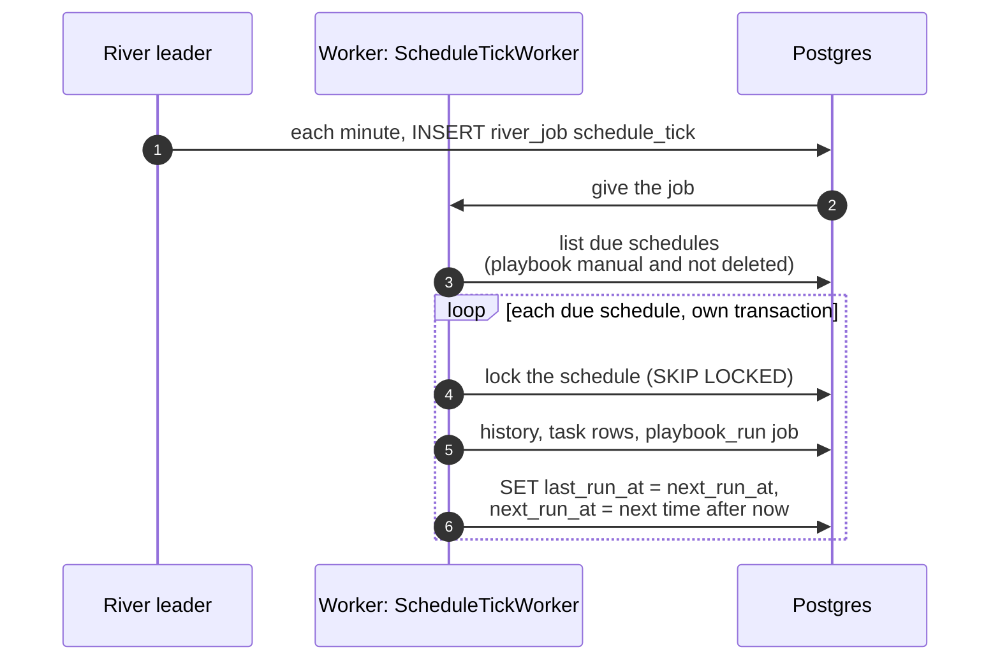

# Schedules

This page explains how a playbook runs on a timetable. It covers the schedule fields, the cron rules, the time zone rules, and the tick job that starts the runs.

## The big picture

| Word | Meaning |
|---|---|
| Schedule | One row in `schedulers`. It runs one playbook with a crontab timetable in a time zone. A playbook can have many schedules. |
| Tick | A River job of kind `schedule_tick`. It runs each minute and starts the due schedules. |
| Due | A schedule is due when it is enabled and `next_run_at` is in the past. |

A schedule can point only to a playbook with the `manual` trigger. The run keeps `trigger_type = manual`, has no `triggered_by`, and has `schedule_id` set. The run list shows the schedule name.

## Cron rules

- Only the standard 5 fields: minute, hour, day of month, month, day of week.
- No `@daily` or `@hourly`. No seconds field. The smallest step is 1 minute.
- The `timezone` is an IANA name. The default is `UTC`. The API refuses an unknown name.
- A time that does not exist (the clock jumps forward) runs when the clock jumps over it.
- A time that occurs two times (the clock goes back) runs one time.

The API computes the next times, so the UI needs no cron library. `POST /api/v1/schedules/preview` returns the next 3 times.

## How the tick works

- The job is unique for each minute, so a slow tick does not make a second tick.
- The next time is always computed from now. A run that was due during a downtime is skipped.
- A run is queued also when the last run of the schedule is not finished.
- One bad schedule (for example a playbook with no start step) does not block the others. The tick logs it and moves `next_run_at` forward, with no run.
- The tick skips a schedule when its playbook is deleted or is not manual any more. The schedule works again when the playbook is restored or set back to manual.

## Run input

| Field | Value |
|---|---|
| `parameters` | The schedule `parameters` plus `scheduled_at` (RFC 3339, UTC). |
| `module_type` and `records` | Empty. |

## Routes and grants

| Route | Grant |
|---|---|
| `GET /api/v1/schedules`, `GET /api/v1/schedules/:id`, `POST /api/v1/schedules/preview` | `schedules: read` |
| `POST /api/v1/schedules`, `PATCH /api/v1/schedules/:id` | `schedules: create` or `update`, and `playbooks: execute` |
| `DELETE /api/v1/schedules/:id` | `schedules: delete` |
