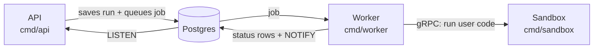
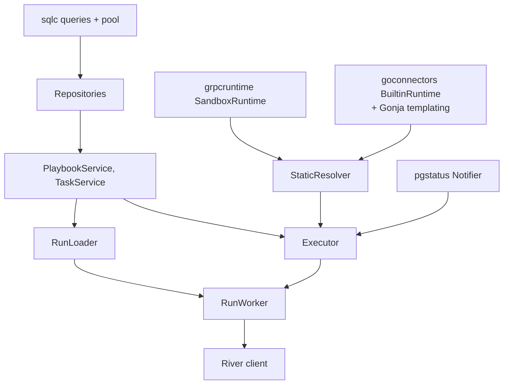
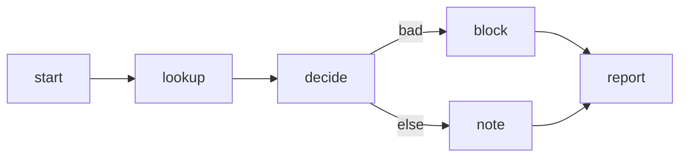
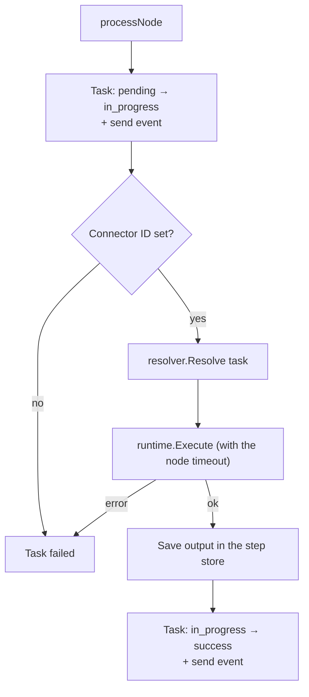
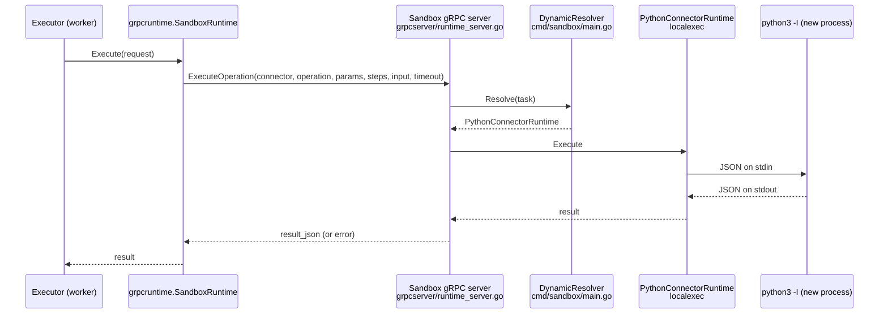

# Worker guide: from start-up to a finished run

This guide explains everything the worker does. It follows the code in the order that it runs. Each part has an example. File paths are under `app/ytsoar/`.

You will learn:

1. What the worker is, and which objects it builds at start-up.
2. How the objects connect (dependency injection by hand).
3. What happens when a job arrives, with a full example playbook.
4. How the executor runs the nodes in order, at the same time, and with branches.
5. How one node runs: in the worker or in the sandbox.
6. What happens when something fails, and how the worker stops.

Read [run-flow.md](diagram/run-flow.md) for the short picture first, if you like.

---

## 1. What the worker is

The worker is a program: `cmd/worker/main.go`. It has no HTTP server. It does one job: it takes **runs** from the queue and executes them.



Three programs share one Go module. The worker is the only one that executes the graph of a playbook.

---

## 2. Start-up: the worker builds its objects

`main.go` builds every object itself and passes it to the next one through the constructor. This is **dependency injection by hand**. There is no framework.

### A tiny example of the idea

```go
// A service needs a repository. It asks for it in the constructor.
type TaskService struct{ repo TaskRepository }          // TaskRepository is an interface
func NewTaskService(repo TaskRepository) *TaskService { return &TaskService{repo: repo} }

// main.go decides which repository to give it.
repo := repository.NewTaskRepositoryImpl(...)           // the real one (Postgres)
service := NewTaskService(repo)                         // in a test: pass a mock instead
```

The service never creates its own repository. So you can replace the repository in a test.

### The objects, in the order that `main.go` builds them

| # | Object | Built by | Needs | Used by | What it does |
|---|---|---|---|---|---|
| 1 | Config | `config.Load()` | environment | all | Reads the settings (`DB_*`, `SANDBOX_ADDR`, limits). |
| 2 | Logger | `logger.SetupLogger()` | none | all | Writes logs. Every object receives it. |
| 3 | Stop signal | `signal.NotifyContext` | none | `main` | A context that ends on SIGINT or SIGTERM. |
| 4 | DB pool and queries | `db.NewPool`, `db.New` | DB URL | repositories, River | Connections to Postgres and the sqlc queries. |
| 5 | Repositories | `repository.NewPlaybookRepository`, `NewTaskRepositoryImpl` | queries, pool | services | Read and write the `playbook_history` and `task_history` tables. |
| 6 | Services | `playbooks.NewPlaybookService`, `tasks.NewTaskServiceImpl` | repositories | executor, loader | Small business logic over the repositories. |
| 7 | Sandbox runtime | `grpcruntime.NewSandboxRuntime` | `SANDBOX_ADDR` | resolver | Sends a task to the sandbox over gRPC (`SandboxRuntime`). |
| 8 | Templating engine | `templating.NewGonjaEngine` | none | built-in runtime | Fills `{{ ... }}` in parameters. |
| 9 | Built-in runtime | `goconnectors.NewBuiltinRuntime` + `Register` | engine, connectors dir | resolver | Runs the trusted connector `http_request` inside the worker (`BuiltinRuntime`). |
| 10 | Resolver | `execution.NewStaticResolver` | sandbox runtime, built-in runtime | executor | Decides where a node runs. See [runtime-resolver.md](runtime-resolver.md). |
| 11 | Status notifier | `pgstatus.NewNotifier` | pool | executor | Sends a Postgres `NOTIFY` when a status changes. |
| 12 | **Executor** | `execution.NewExecutor` | services, resolver, notifier, limits | job worker | Runs the graph of one playbook. |
| 13 | Run loader | `playbooks.NewRunLoader` | services | job worker | Builds the full message of a run from the database. |
| 14 | Job worker | `jobs.NewRunWorker` | logger, loader, executor | River | The small wrapper that River calls for each job. |
| 15 | River client | `jobs.NewWorkerClient` | pool, job worker, limits | `main` | Takes jobs from Postgres and calls the job worker. |

Then `main.go` calls `riverClient.Start(...)` and waits for the stop signal.

### The dependency picture



Each arrow means "is passed into the constructor of". The executor is in the middle: it gets everything it needs and does not build anything itself.

---

## 3. A job arrives: the example playbook

We use this playbook for all later examples. It blocks a bad IP address.



| Node | Connector | What it does |
|---|---|---|
| `start` | none | A no-op node. Every playbook begins here. |
| `lookup` | `http_request` (built-in) | Calls a threat-intel URL. Result example: `{"score": 92}`. |
| `decide` | `condition` (Python connector) | If `score > 80`, it returns `{"result": "bad"}`. Otherwise `{"result": "else"}`. |
| `block` | `firewall` (Python connector) | Blocks the IP address. |
| `note` | `slack` (Python connector) | Writes a message. |
| `report` | `slack` (Python connector) | Reports the result. |

The `lookup` node has this parameter:

```json
{ "url": "https://intel.example/ip/{{ var.input.records[0].payload.ip }}" }
```

### What the job holds

The job holds only the run ID:

```json
{ "playbook_history_id": "0134ca34-c395-4162-a667-21a6afabdc13" }
```

### What the worker does first

`RunWorker.Work` (`internal/adapters/jobs/jobs.go`) calls `RunLoader.LoadRunMessage` (`internal/application/playbooks/orchestrator.go`). The loader reads the saved rows and builds a **TaskMessage** (`internal/domain/message.go`):

```json
{
  "playbook_history_id": "0134ca34-...",
  "graph": {
    "start":  ["lookup"],
    "lookup": ["decide"],
    "decide": ["block", "note"],
    "block":  ["report"],
    "note":   ["report"],
    "report": []
  },
  "edges": [
    { "source": "decide", "destination": "block", "source_handle": "bad" },
    { "source": "decide", "destination": "note",  "source_handle": "else" }
  ],
  "tasks": { "lookup": { "connector_id": "http_request", "operation": "get_request", "...": "..." } },
  "input": { "module_type": "alert", "records": [ { "payload": { "ip": "203.0.113.9" } } ] }
}
```

- `graph` is an adjacency list: node name → the nodes that come next.
- `edges` holds the **handles**. A handle is the label of a branch (`bad`, `else`).
- `tasks` holds the full definition of each node.
- `input` is the data that started the run, for example an alert.

Then `Work` calls `Executor.Run(ctx, message)`.

---

## 4. The executor runs the graph

The executor is `internal/application/execution/executor.go`. `Run` does these things in order.

### 4.1 Start the run

`Run` first moves the run from `queued` to `in_progress`. The database refuses the move if the run is already started. In that case `recoverRun` marks the run `failed`, so the connectors never run twice. See [statuses.md](diagram/statuses.md).

### 4.2 Check the graph

- A graph with a cycle fails the run: "graph contains a cycle".
- An empty graph fails the run: "playbook message has no graph nodes".

### 4.3 Decide the order (Kahn's algorithm)

The executor counts, for each node, how many nodes must finish before it. This count is the **indegree**.

For the example:

| Node | Indegree | Meaning |
|---|---|---|
| `start` | 0 | Can run now. |
| `lookup` | 1 | Waits for `start`. |
| `decide` | 1 | Waits for `lookup`. |
| `block` | 1 | Waits for `decide`. |
| `note` | 1 | Waits for `decide`. |
| `report` | 2 | Waits for `block` and `note`. |

The rule is simple:

1. Start every node with indegree 0.
2. When a node finishes, lower the indegree of each child by 1.
3. When a child reaches 0, start it.

### 4.4 Run nodes at the same time

Each node starts in its own goroutine. A **semaphore** limits how many run together (`MAX_PARALLEL_NODES`, default 4):

```go
sem := make(chan struct{}, e.maxParallel)   // a box with 4 places
// a node goroutine does:
sem <- struct{}{}          // take a place (wait if the box is full)
defer func() { <-sem }()   // give the place back when done
```

Each finished node sends its result on the `done` channel. The main loop of `Run` reads `done`, lowers the indegree of the children and starts the new ready nodes.

### 4.5 Branches: which child runs?

When `decide` finishes, its output is `{"result": "bad"}`. For each edge, `edgeFollowed` compares the edge handle with the result:

| Edge | Handle | Output result | Followed? |
|---|---|---|---|
| `decide → block` | `bad` | `bad` | Yes |
| `decide → note` | `else` | `bad` | No |

The executor counts the followed edges for each child (`followedCount`). A child with indegree 0 and **zero followed edges** is **skipped**: `note` gets the status `skipped`, and it does not run. A skipped node does not follow its own edges. A child that has at least one followed edge still runs. So `report` runs, because `block` followed it.

### 4.6 The example, round by round

| Round | Finished | Started | Notes |
|---|---|---|---|
| 0 | | `start` | Indegree 0. |
| 1 | `start` | `lookup` | |
| 2 | `lookup` (`{"score": 92}`) | `decide` | |
| 3 | `decide` (`{"result": "bad"}`) | `block` and `note` (skipped) | Both start together. |
| 4 | `block`, `note` (skipped) | `report` | Indegree is 0 after both finish. `block` followed it, so it runs. |
| 5 | `report` | none | All done. The run becomes `success`. |

### 4.7 The step store: how a node reads earlier results

`StepStore` (`internal/application/execution/store.go`) keeps the output of every finished node, by node name:

```json
{ "lookup": { "score": 92 }, "decide": { "result": "bad" } }
```

Before a node runs, the executor takes a snapshot of the store. The node can use the snapshot in a template:

```
{{ var.steps["lookup"].score }}      →  92
```

The store never changes in place. Each `Set` makes a new copy, so a snapshot is safe to share between nodes that run at the same time.

---

## 5. How one node runs (`processNode`)



The `start` node is special. It is a no-op and it only reports `success`.

### 5.1 Path A: a built-in connector runs in the worker

For `lookup` (`http_request`), the resolver returns the **BuiltinRuntime** (`internal/adapters/runtimes/goconnectors/builtin_runtime.go`). Its `Execute` does this:

1. Decode the parameters of the task: `{"url": "https://intel.example/ip/{{ var.input.records[0].payload.ip }}"}`.
2. **Render the templates** with the steps and the input. The result is `{"url": "https://intel.example/ip/203.0.113.9"}`.
3. Load the TOML config, if the task names one (`<connector>/configs/<name>.toml`).
4. Call the connector: `HTTPRequestConnector.Execute(ctx, config, params, "get_request")`.
5. Turn the result into JSON.

Only first-party code is registered here (`http_request`). The worker trusts it.

### 5.2 Path B: user code runs in the sandbox

For `block` (a Python connector), the resolver returns the **SandboxRuntime** (`internal/adapters/runtimes/grpcruntime/sandbox_runtime.go`). It sends the node to the sandbox:



Safety rules in the sandbox (`internal/adapters/runtimes/localexec/localexec.go`):

- Every node gets a **new** `python3 -I` or `node` process.
- The process gets a clean environment: only `PATH`. It has no database or queue credentials.
- A memory limit applies.
- A time limit applies. After the limit, the sandbox kills the whole process group.
- The data goes in as JSON on stdin. The result comes back as JSON on stdout. Nothing is written to disk.

### 5.3 Why two paths?

The split is about **trust**. Code that the team wrote runs in the worker. Code that a user writes runs in the sandbox, where it cannot reach the database.

---

## 6. When things go wrong

### 6.1 A node fails

Example: `lookup` gets an HTTP 500.

1. `processNode` saves the task as `failed` with the error text.
2. The main loop of `Run` sees the error. It stores it as `runErr` and calls `cancel()`. This is **fail-fast**.
3. `cancel()` ends the context of every node that is still running. Those nodes fail too.
4. The executor starts no new node. Nodes that never started stay `pending`.
5. `finishPlaybook` moves the run to `failed` with the error text.

### 6.2 The final status must be saved

After `cancel()`, the context is dead. A normal database call with it would fail. So `setRunStatus` and `setTaskStatus` use `context.WithoutCancel(ctx)`. The failed status is saved even after a cancel, a timeout or a shutdown.

### 6.3 Time limits

| Limit | Setting | Where it applies |
|---|---|---|
| One node | `NODE_TIMEOUT_SECONDS` (300) | `context.WithTimeout` in `processNode`. The sandbox gets the same value. |
| One run | `RUN_TIMEOUT_MINUTES` (60) | River `JobTimeout` in `NewWorkerClient`. |
| Worker stop | `WORKER_STOP_GRACE_SECONDS` (20) | River `SoftStopTimeout`. After this time, River cancels the running playbooks. |

### 6.4 The worker stops in the middle of a run

**You stop the worker on purpose** (a deploy, Ctrl+C). The running playbooks get `WORKER_STOP_GRACE_SECONDS` (20 seconds) to finish. After that, River cancels them. Each cancelled run is saved as `failed` at once, and the worker exits. See section 8.

**The worker dies** (a crash, or `kill -9`). River finds a job that is still `running` after the run timeout plus 5 minutes (at least). It then gives the job to another worker. That worker calls `Run`, and the database refuses `queued → in_progress`. Then `recoverRun` marks the run `failed`. The connectors do not run again. See [job-results.md](diagram/job-results.md).

### 6.4a A panic in a node

A panic in a node goroutine would stop the whole worker. River catches a panic only in the job goroutine. So each node goroutine in `Run` has a `recover`. The panic becomes an error: the task and the run are saved as `failed`, and the worker keeps running.

### 6.4b The final status cannot be saved

After the last node, the executor saves the final status of the run. If the database fails, it tries again after 1, 2, 4, 8 and 15 seconds (about 30 seconds). If every try fails, `Run` returns `ErrNotFinished`. `Work` returns this error, and River gives the job to attempt 2. Attempt 2 marks the run `failed`.

### 6.5 What `Work` returns to River

| Result of `Run` | `Work` returns | River does |
|---|---|---|
| Success | `nil` | Marks the job completed. |
| The run failed (saved) | `nil` | Marks the job completed. A retry would run the connectors again. |
| The run could not start (`ErrNotStarted`, or the message could not be built) | `nil` | `Abort` marks the run `failed` at once. No retry. If `Abort` fails, the error goes to River, and attempt 2 tries again. |
| The final status was not saved (`ErrNotFinished`) | the error | River gives the job to attempt 2. It marks the run `failed`. |

---

## 7. Status events: how the browser learns

Each time a status changes, the executor calls `Notifier.Publish(ctx, "task_status", rowID)`. This runs `SELECT pg_notify(...)` with the event name and the row ID. The API listens (`LISTEN ytsoar_status`), loads the row and sends it to the browser over WebSocket. The payload holds only the ID, because a `NOTIFY` payload is limited to 8000 bytes.

---

## 8. Shutdown

1. You press Ctrl+C, or Docker sends SIGTERM.
2. `ctx.Done()` ends. `main.go` moves on from `<-ctx.Done()`.
3. `riverClient.Stop(stopCtx)` stops taking new jobs and waits for the running playbooks. The wait is `WORKER_STOP_GRACE_SECONDS` (20 seconds).
4. After that time, River cancels the running playbooks. Each run is saved as `failed` with a "cancelled" error, and the worker exits.
5. In the compose file, `stop_grace_period: 60s` is longer than the grace time, so the worker has time to save the statuses before Docker kills it. Note: in dev, the worker runs under `air`. We have not checked that `air` passes the stop signal to the worker. If it does not, the grace time does not work in dev, and the runs stay `in_progress` until River rescues the job.

River started with `context.Background()`, not with `ctx`. If River used `ctx`, SIGTERM would cancel the running playbooks at once.

---

## 9. Questions and answers

**Why does the job hold only the run ID?**
The `river_job` table stays small. The data is already in the history tables. The worker builds the message when it needs it.

**Why does `Executor.Run` not build anything?**
It gets its parts in the constructor. A test passes mocks for the services, the resolver and the notifier. See `executor_test.go`.

**Why is there a sandbox at all?**
User code is not trusted. It must not reach the database or the credentials of the worker.

**What is a `TaskRuntime`?** (A runtime that runs one task, which is one node of the playbook.)
An interface with one method, `Execute`. `BuiltinRuntime`, `SandboxRuntime` and the four sandbox runtimes all implement it. Every type that fits it has a name that ends with `Runtime`. The executor only knows the interface.

**What if two workers take the same run?**
The database allows `queued → in_progress` once. The second worker is refused and goes to `recoverRun`.

---

## 10. Where to read the code

| Order | File | Read |
|---|---|---|
| 1 | `cmd/worker/main.go` | The whole file (about 100 lines). |
| 2 | `internal/adapters/jobs/jobs.go` | `RunArgs`, `RunWorker.Work`, `NewWorkerClient`. |
| 3 | `internal/application/playbooks/orchestrator.go` | `RunLoader.LoadRunMessage`. |
| 4 | `internal/application/execution/executor.go` | `Run`, then `processNode`, then `recoverRun`. |
| 5 | `internal/application/execution/resolver.go` | `StaticResolver.Resolve`. |
| 6 | `internal/adapters/runtimes/goconnectors/builtin_runtime.go` | `BuiltinRuntime.Execute`. |
| 7 | `internal/adapters/runtimes/grpcruntime/sandbox_runtime.go` | `SandboxRuntime.Execute`. |
| 8 | `internal/adapters/grpcserver/runtime_server.go` | `ExecuteOperation`. |
| 9 | `internal/adapters/runtimes/localexec/` | `localexec.go`, then `python_connector_runtime.go`. |
| 10 | `internal/application/execution/executor_test.go` | Tests for the diamond graph, fail-fast and branches. |

To see the branch rules in action, read `TestExecutorConditionFollowsTruePathSkipsFalse` and `TestExecutorJoinRunsWhenOneParentFollowed` in `executor_test.go`.
